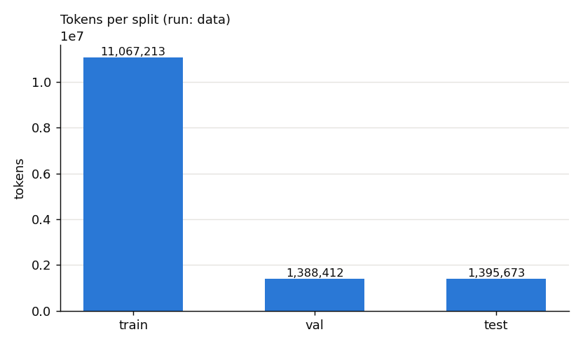
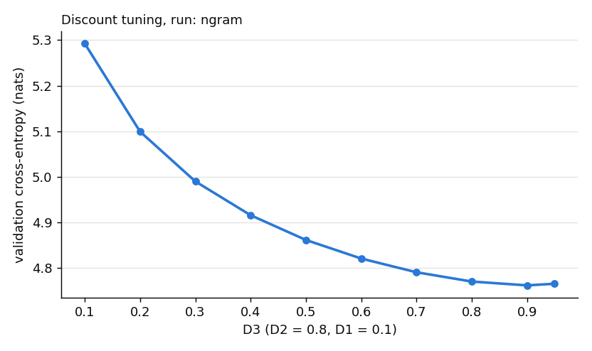
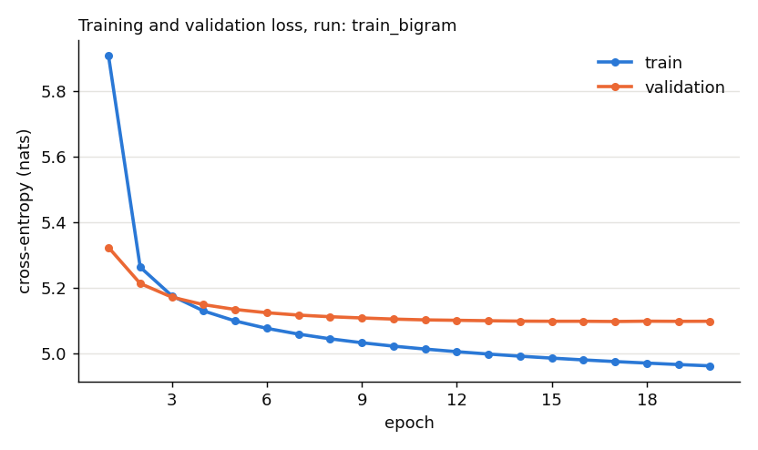
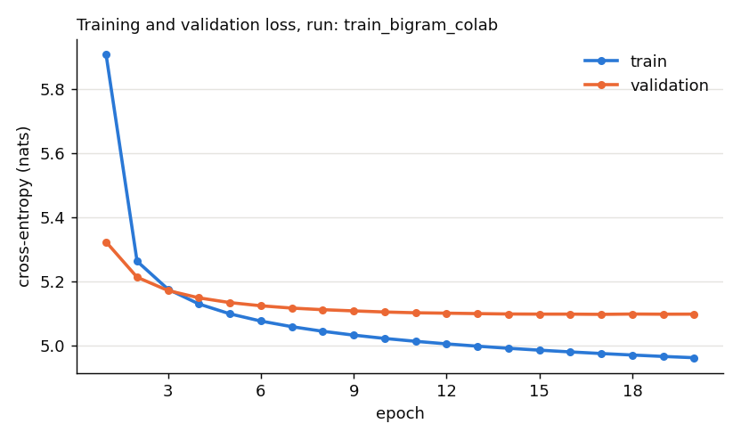
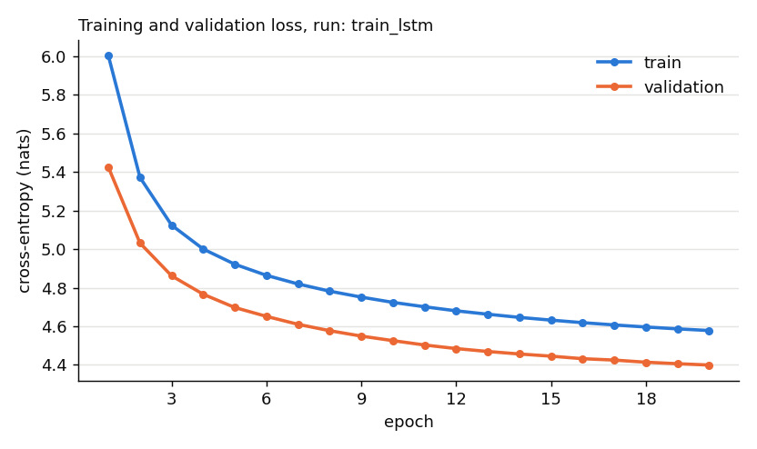
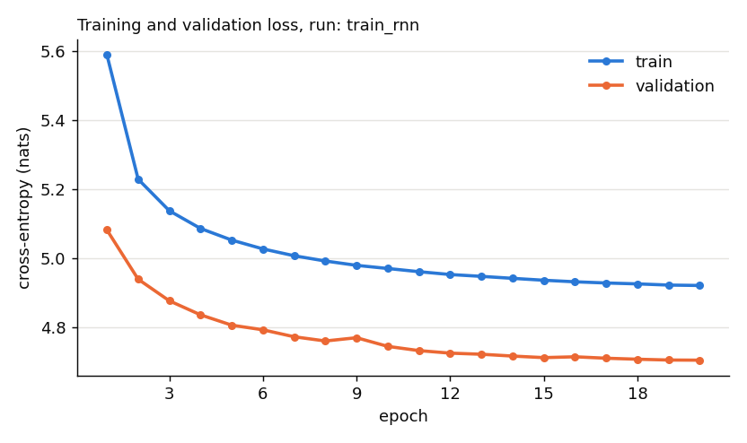
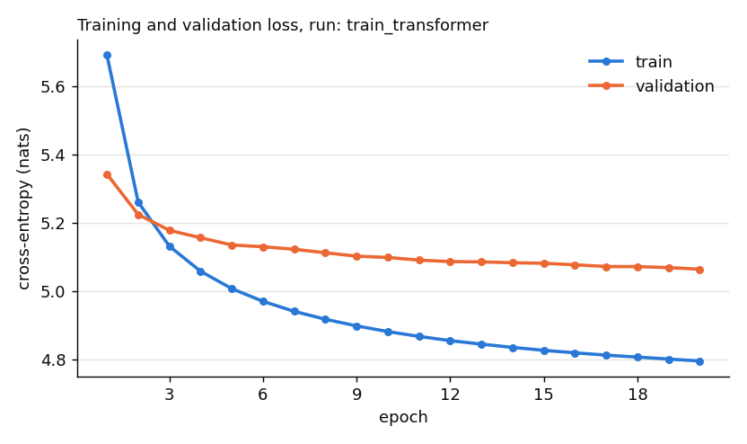
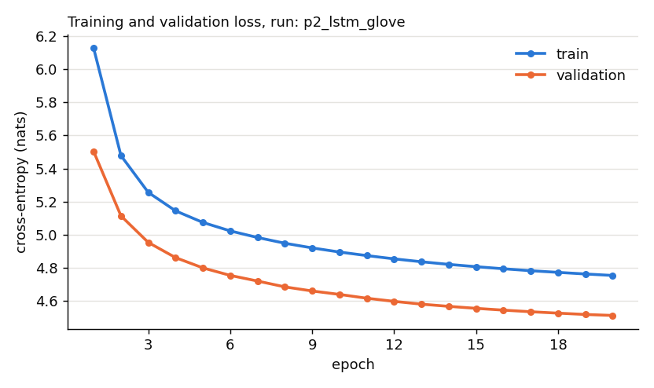
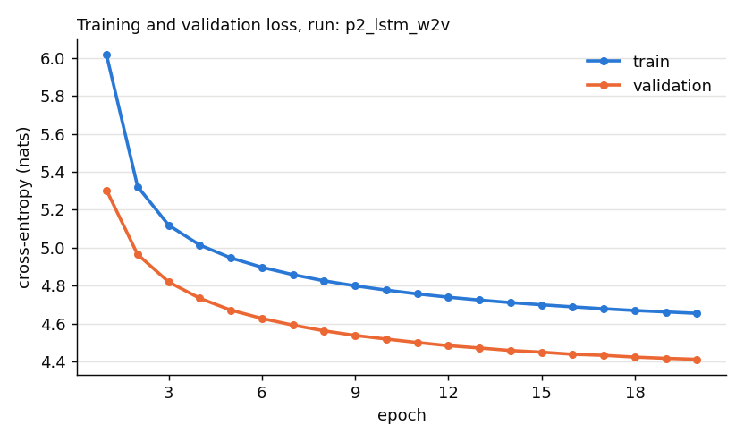
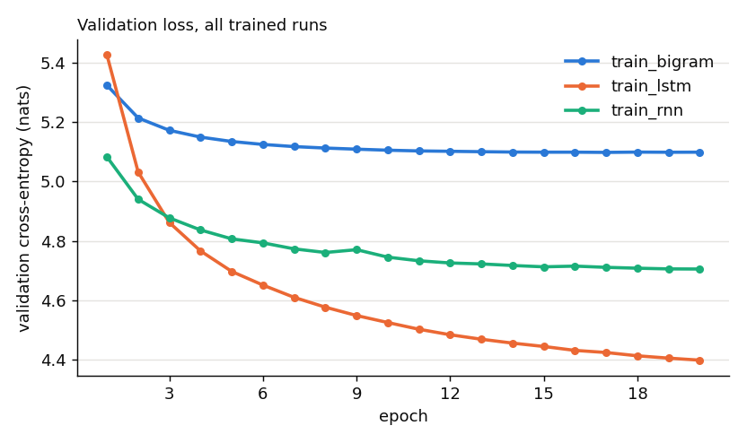

# Results

Rebuilt by `src/update_results.py` on 2026-10-15T16:27:53+08:00 from 37 run records in `results/`, `DECISIONS.md` and `results/RESULTS_LOG.md`. Newest run record: 2026-10-15T16:20:38+08:00. Do not edit outside the *My notes* blocks; they are rebuilt each time.

Contents: [Data](#data) · [Part I](#part-i) · [Part II](#part-ii) · [Part III](#part-iii) · [Settings](#settings) · [Checks](#checks)

## Data

#### `data`

| Field | Value |
|---|---|
| Command | `/usr/local/bin/python3 src/data.py --config configs/data.json` (copied from results/RESULTS_LOG.md) |
| Script | `src/data.py` |
| Date | 2026-10-10T22:43:28+08:00 |
| Git commit | `8764c2a (uncommitted changes at run time)` |
| Hardware | CPU: Apple M2 (Darwin arm64) |
| Seed | 0 |
| Result file | `results/data.json` |

**Settings used**

| Setting | Value |
|---|---|
| `architecture` | — |
| `layers` | — |
| `hidden_size` | — |
| `embedding_dim` | — |
| `embedding_init` | — |
| `context_length` | — |
| `learning_rate` | — |
| `batch_size` | — |
| `epochs` | — |
| `dropout` | — |
| `vocab_size` | 20,000 |
| `subsample_size` | — |
| `seed` | 0 |
| `options.data_path` | data/IMDB Dataset.csv |
| `options.output_dir` | data/processed |
| `options.val_frac` | 0.1000 |
| `options.test_frac` | 0.1000 |

**Key numbers**

| Metric | Value |
|---|---|
| `vocab_size_with_special_tokens` | 20,003 |
| `splits.train.num_reviews` | 40,000 |
| `splits.train.num_tokens` | 11,067,213 |
| `splits.train.unk_rate` | 0.0207 |
| `splits.val.num_reviews` | 5,000 |
| `splits.val.num_tokens` | 1,388,412 |
| `splits.val.unk_rate` | 0.0223 |
| `splits.test.num_reviews` | 5,000 |
| `splits.test.num_tokens` | 1,395,673 |
| `splits.test.unk_rate` | 0.0224 |

#### `inspect_data`

| Field | Value |
|---|---|
| Command | `/usr/local/bin/python3 src/inspect_data.py --config configs/inspect_data.json` (copied from results/RESULTS_LOG.md) |
| Script | `src/inspect_data.py` |
| Date | 2026-10-10T22:43:31+08:00 |
| Git commit | `8764c2a (uncommitted changes at run time)` |
| Hardware | CPU: Apple M2 (Darwin arm64) |
| Seed | 0 |
| Result file | `results/inspect_data.json` |

**Settings used**

| Setting | Value |
|---|---|
| `architecture` | — |
| `layers` | — |
| `hidden_size` | — |
| `embedding_dim` | — |
| `embedding_init` | — |
| `context_length` | — |
| `learning_rate` | — |
| `batch_size` | — |
| `epochs` | — |
| `dropout` | — |
| `vocab_size` | — |
| `subsample_size` | — |
| `seed` | 0 |
| `options.data_path` | data/IMDB Dataset.csv |
| `options.n_examples` | 3 |
| `options.word_budget` | 3,000,000 |
| `options.example_chars` | 500 |
| `options.round_to` | 500 |

**Key numbers**

| Metric | Value |
|---|---|
| `column_names` | `["review", "sentiment"]` |
| `num_reviews` | 50,000 |
| `label_counts.positive` | 25,000 |
| `label_counts.negative` | 25,000 |
| `total_words` | 11,557,847 |
| `avg_review_length` | 231.1569 |
| `num_reviews_with_br_tag` | 29,200 |
| `pct_reviews_with_br_tag` | 58.4000 |
| `subsample_suggestion_reviews` | 12,500 |

#### `show_batch`

| Field | Value |
|---|---|
| Command | `python3 src/data.py --config configs/show_batch.json --show-batch` (copied from results/RESULTS_LOG.md) |
| Script | `src/data.py --show-batch` |
| Date | 2026-10-11T20:22:22+08:00 |
| Git commit | `7ef446d (uncommitted changes at run time)` |
| Hardware | CPU: Apple M2 (Darwin arm64) |
| Seed | 0 |
| Result file | `results/show_batch.json` |

**Settings used**

| Setting | Value |
|---|---|
| `architecture` | — |
| `layers` | — |
| `hidden_size` | — |
| `embedding_dim` | — |
| `embedding_init` | — |
| `context_length` | 64 |
| `learning_rate` | — |
| `batch_size` | 64 |
| `epochs` | — |
| `dropout` | — |
| `vocab_size` | 20,000 |
| `subsample_size` | — |
| `seed` | 0 |
| `options.processed_dir` | data/processed |

**Key numbers**

| Metric | Value |
|---|---|
| `x_shape` | `[64, 64]` |
| `y_shape` | `[64, 64]` |
| `x_dtype` | torch.int64 |
| `y_dtype` | torch.int64 |
| `num_train_windows` | 172,925 |
| `num_train_batches` | 2,702 |
| `y_is_x_shifted_by_one` | True |

### My notes

<!-- my-notes:data:start -->

<!-- my-notes:data:end -->

## Part I

#### `generations_lstm`

| Field | Value |
|---|---|
| Command | `/usr/bin/python3 src/generate.py --config configs/generations_lstm.json` |
| Script | `src/generate.py` |
| Date | 2026-10-13T06:27:12+00:00 |
| Git commit | `5771854` |
| Hardware | GPU: Tesla T4 |
| Seed | 0 |
| Result file | `results/generations_lstm.json` |

**Settings used**

| Setting | Value |
|---|---|
| `architecture` | lstm |
| `layers` | 2 |
| `hidden_size` | 256 |
| `embedding_dim` | 100 |
| `embedding_init` | random |
| `context_length` | — |
| `learning_rate` | — |
| `batch_size` | — |
| `epochs` | — |
| `dropout` | 0.3000 |
| `vocab_size` | 20,000 |
| `subsample_size` | — |
| `seed` | 0 |
| `options.model` | lstm |
| `options.processed_dir` | data/processed |
| `options.prompts_path` | prompts.txt |
| `options.temperature` | 1.0000 |
| `options.top_k` | 40 |
| `options.max_new_tokens` | 50 |
| `options.num_samples` | 1 |
| `options.banned_tokens` | `["&lt;pad&gt;", "&lt;unk&gt;"]` |
| `options.stop_at_eos` | True |
| `options.train_result` | results/train_lstm.json |
| `options.checkpoint` | checkpoints/train_lstm.pt |

**Key numbers**

| Metric | Value |
|---|---|
| `num_prompts` | 3 |
| `num_generations` | 3 |
| `num_ended_with_eos` | 1 |
| `mean_new_tokens` | 35.3333 |

**Details**

| Name | Value |
|---|---|
| `model` | lstm |
| `prompts_path` | prompts.txt |
| `train_result` | results/train_lstm.json |
| `train_run_date` | 2026-10-12T06:19:48+00:00 |
| `train_run_git_commit` | 7b9bbe6758682f640994b57ac1efa86ba487c75d |
| `checkpoint` | checkpoints/train_lstm.pt |
| `num_parameters` | 8,033,999 |
| `device` | cuda |

**Decoding settings**

| Setting | Value |
|---|---|
| `temperature` | 1.0000 |
| `top_k` | 40 |
| `max_tokens` | 50 |
| `seed` | 0 |
| `num_samples` | 1 |
| `banned_tokens` | `["&lt;pad&gt;", "&lt;unk&gt;"]` |
| `stop_at_eos` | True |

#### `generations_ngram`

| Field | Value |
|---|---|
| Command | `/usr/local/bin/python3 src/generate.py --config configs/generations_ngram.json` (copied from results/RESULTS_LOG.md) |
| Script | `src/generate.py` |
| Date | 2026-10-11T01:05:20+08:00 |
| Git commit | `ee7c0d9 (uncommitted changes at run time)` |
| Hardware | CPU: Apple M2 (Darwin arm64) |
| Seed | 0 |
| Result file | `results/generations_ngram.json` |

**Settings used**

| Setting | Value |
|---|---|
| `architecture` | trigram_kneser_ney |
| `layers` | — |
| `hidden_size` | — |
| `embedding_dim` | — |
| `embedding_init` | — |
| `context_length` | 2 |
| `learning_rate` | — |
| `batch_size` | — |
| `epochs` | — |
| `dropout` | — |
| `vocab_size` | 20,000 |
| `subsample_size` | — |
| `seed` | 0 |
| `options.model` | ngram |
| `options.processed_dir` | data/processed |
| `options.ngram_results_path` | results/ngram.json |
| `options.prompts_path` | prompts.txt |
| `options.temperature` | 1.0000 |
| `options.top_k` | 40 |
| `options.max_new_tokens` | 50 |
| `options.num_samples` | 1 |
| `options.banned_tokens` | `["&lt;pad&gt;", "&lt;unk&gt;"]` |
| `options.stop_at_eos` | True |

**Key numbers**

| Metric | Value |
|---|---|
| `num_prompts` | 3 |
| `num_generations` | 3 |
| `num_ended_with_eos` | 1 |
| `mean_new_tokens` | 41.0000 |

**Details**

| Name | Value |
|---|---|
| `model` | ngram |
| `prompts_path` | prompts.txt |
| `ngram_results_path` | results/ngram.json |
| `ngram_run_date` | 2026-10-10T22:44:32+08:00 |
| `ngram_run_git_commit` | 8764c2a535ca4f8980bd2386e6aebbb01af0f22b |
| `discounts.d3` | 0.9000 |
| `discounts.d2` | 0.8000 |
| `discounts.d1` | 0.1000 |

**Decoding settings**

| Setting | Value |
|---|---|
| `temperature` | 1.0000 |
| `top_k` | 40 |
| `max_tokens` | 50 |
| `seed` | 0 |
| `num_samples` | 1 |
| `banned_tokens` | `["&lt;pad&gt;", "&lt;unk&gt;"]` |
| `stop_at_eos` | True |

#### `generations_rnn`

| Field | Value |
|---|---|
| Command | `/usr/bin/python3 src/generate.py --config configs/generations_rnn.json` |
| Script | `src/generate.py` |
| Date | 2026-10-13T06:27:04+00:00 |
| Git commit | `5771854` |
| Hardware | GPU: Tesla T4 |
| Seed | 0 |
| Result file | `results/generations_rnn.json` |

**Settings used**

| Setting | Value |
|---|---|
| `architecture` | rnn |
| `layers` | 2 |
| `hidden_size` | 256 |
| `embedding_dim` | 100 |
| `embedding_init` | random |
| `context_length` | — |
| `learning_rate` | — |
| `batch_size` | — |
| `epochs` | — |
| `dropout` | 0.3000 |
| `vocab_size` | 20,000 |
| `subsample_size` | — |
| `seed` | 0 |
| `options.model` | rnn |
| `options.processed_dir` | data/processed |
| `options.prompts_path` | prompts.txt |
| `options.temperature` | 1.0000 |
| `options.top_k` | 40 |
| `options.max_new_tokens` | 50 |
| `options.num_samples` | 1 |
| `options.banned_tokens` | `["&lt;pad&gt;", "&lt;unk&gt;"]` |
| `options.stop_at_eos` | True |
| `options.train_result` | results/train_rnn.json |
| `options.checkpoint` | checkpoints/train_rnn.pt |

**Key numbers**

| Metric | Value |
|---|---|
| `num_prompts` | 3 |
| `num_generations` | 3 |
| `num_ended_with_eos` | 0 |
| `mean_new_tokens` | 50.0000 |

**Details**

| Name | Value |
|---|---|
| `model` | rnn |
| `prompts_path` | prompts.txt |
| `train_result` | results/train_rnn.json |
| `train_run_date` | 2026-10-12T07:16:34+00:00 |
| `train_run_git_commit` | 7b9bbe6758682f640994b57ac1efa86ba487c75d |
| `checkpoint` | checkpoints/train_rnn.pt |
| `num_parameters` | 7,364,303 |
| `device` | cuda |

**Decoding settings**

| Setting | Value |
|---|---|
| `temperature` | 1.0000 |
| `top_k` | 40 |
| `max_tokens` | 50 |
| `seed` | 0 |
| `num_samples` | 1 |
| `banned_tokens` | `["&lt;pad&gt;", "&lt;unk&gt;"]` |
| `stop_at_eos` | True |

#### `generations_transformer`

| Field | Value |
|---|---|
| Command | `/usr/bin/python3 src/generate.py --config configs/generations_transformer.json` |
| Script | `src/generate.py` |
| Date | 2026-10-13T06:27:17+00:00 |
| Git commit | `5771854` |
| Hardware | GPU: Tesla T4 |
| Seed | 0 |
| Result file | `results/generations_transformer.json` |

**Settings used**

| Setting | Value |
|---|---|
| `architecture` | transformer |
| `layers` | 2 |
| `hidden_size` | 256 |
| `embedding_dim` | 100 |
| `embedding_init` | random |
| `context_length` | — |
| `learning_rate` | — |
| `batch_size` | — |
| `epochs` | — |
| `dropout` | 0.3000 |
| `vocab_size` | 20,000 |
| `subsample_size` | — |
| `seed` | 0 |
| `options.model` | transformer |
| `options.processed_dir` | data/processed |
| `options.prompts_path` | prompts.txt |
| `options.temperature` | 1.0000 |
| `options.top_k` | 40 |
| `options.max_new_tokens` | 50 |
| `options.num_samples` | 1 |
| `options.banned_tokens` | `["&lt;pad&gt;", "&lt;unk&gt;"]` |
| `options.stop_at_eos` | True |
| `options.train_result` | results/train_transformer.json |
| `options.checkpoint` | checkpoints/train_transformer.pt |

**Key numbers**

| Metric | Value |
|---|---|
| `num_prompts` | 3 |
| `num_generations` | 3 |
| `num_ended_with_eos` | 1 |
| `mean_new_tokens` | 48.6667 |

**Details**

| Name | Value |
|---|---|
| `model` | transformer |
| `prompts_path` | prompts.txt |
| `train_result` | results/train_transformer.json |
| `train_run_date` | 2026-10-12T15:05:12+00:00 |
| `train_run_git_commit` | b59b5edeba923436751d1a65b48aee466c30e47e |
| `checkpoint` | checkpoints/train_transformer.pt |
| `num_parameters` | 4,231,115 |
| `device` | cuda |

**Decoding settings**

| Setting | Value |
|---|---|
| `temperature` | 1.0000 |
| `top_k` | 40 |
| `max_tokens` | 50 |
| `seed` | 0 |
| `num_samples` | 1 |
| `banned_tokens` | `["&lt;pad&gt;", "&lt;unk&gt;"]` |
| `stop_at_eos` | True |

#### `ngram`

| Field | Value |
|---|---|
| Command | `/usr/local/bin/python3 src/ngram.py --config configs/ngram.json` (copied from results/RESULTS_LOG.md) |
| Script | `src/ngram.py` |
| Date | 2026-10-10T22:44:32+08:00 |
| Git commit | `8764c2a (uncommitted changes at run time)` |
| Hardware | CPU: Apple M2 (Darwin arm64) |
| Seed | 0 |
| Result file | `results/ngram.json` |

**Settings used**

| Setting | Value |
|---|---|
| `architecture` | trigram_kneser_ney |
| `layers` | — |
| `hidden_size` | — |
| `embedding_dim` | — |
| `embedding_init` | — |
| `context_length` | 2 |
| `learning_rate` | — |
| `batch_size` | 32 |
| `epochs` | — |
| `dropout` | — |
| `vocab_size` | 20,000 |
| `subsample_size` | — |
| `seed` | 0 |
| `options.processed_dir` | data/processed |
| `options.max_length` | — |
| `options.discount_grid` | `[0.1, 0.2, 0.3, 0.4, 0.5, 0.6, 0.7, 0.8, 0.9, 0.95]` |

**Key numbers**

| Metric | Value |
|---|---|
| `val.avg_cross_entropy` | 4.7617 |
| `val.perplexity` | 116.9503 |
| `val.num_targets` | 1,383,412 |
| `val.target_checksum` | 3db6b4677ec60f9fe6ed02f5be7cd8d3a496c3fddf2bed091a56e3cbcabc7ac6 |
| `test.avg_cross_entropy` | 4.7582 |
| `test.perplexity` | 116.5364 |
| `test.num_targets` | 1,390,673 |
| `test.target_checksum` | fd778f4c313dbc0796c6f97a40326932017a8e742b6f6905c422d4ab929d1818 |

**Details**

| Name | Value |
|---|---|
| `vocab_size_with_special_tokens` | 20,003 |
| `best_discounts.d3` | 0.9000 |
| `best_discounts.d2` | 0.8000 |
| `best_discounts.d1` | 0.1000 |
| `train_seconds` | 0.8364 |
| `tune_seconds` | 22.7996 |
| `model_size.trigram_types` | 5,031,011 |
| `model_size.bigram_types` | 1,394,329 |
| `model_size.unigram_types` | 20,002 |
| `model_size.total_stored_counts` | 6,445,342 |
| `model_size.trigram_context_rows` | 1,396,523 |
| `model_size.bigram_context_rows` | 20,001 |
| `tuning_grid` | (1000 entries; see the run's JSON file) |

#### `sanity_check`

| Field | Value |
|---|---|
| Command | `/usr/local/bin/python3 src/sanity_check.py --config configs/sanity_check.json` (copied from results/RESULTS_LOG.md) |
| Script | `src/sanity_check.py` |
| Date | 2026-10-10T22:44:00+08:00 |
| Git commit | `8764c2a (uncommitted changes at run time)` |
| Hardware | CPU: Apple M2 (Darwin arm64) |
| Seed | 0 |
| Result file | `results/sanity_check.json` |

**Settings used**

| Setting | Value |
|---|---|
| `architecture` | bigram_lm |
| `layers` | — |
| `hidden_size` | — |
| `embedding_dim` | 100 |
| `embedding_init` | random |
| `context_length` | 1 |
| `learning_rate` | — |
| `batch_size` | 32 |
| `epochs` | — |
| `dropout` | — |
| `vocab_size` | 20,000 |
| `subsample_size` | — |
| `seed` | 0 |
| `options.processed_dir` | data/processed |
| `options.max_length` | 256 |

**Key numbers**

| Metric | Value |
|---|---|
| `val_perplexity_untrained` | 23,926.52 |
| `val_avg_nll_untrained` | 10.0827 |
| `val_num_target_tokens` | 983,447 |

**Details**

| Name | Value |
|---|---|
| `vocab_size_with_special_tokens` | 20,003 |

#### `test_causality`

| Field | Value |
|---|---|
| Command | `/usr/local/bin/python3 tests/test_causality.py --config configs/test_causality.json` |
| Script | `tests/test_causality.py` |
| Date | 2026-10-14T17:07:48+08:00 |
| Git commit | `54c5b04 (uncommitted changes at run time)` |
| Hardware | CPU: Apple M2 (Darwin arm64) |
| Seed | 0 |
| Result file | `results/test_causality.json` |

**Settings used**

| Setting | Value |
|---|---|
| `architecture` | — |
| `layers` | 2 |
| `hidden_size` | 16 |
| `embedding_dim` | 100 |
| `embedding_init` | random |
| `context_length` | — |
| `learning_rate` | — |
| `batch_size` | 4 |
| `epochs` | — |
| `dropout` | 0.3000 |
| `vocab_size` | 50 |
| `subsample_size` | — |
| `seed` | 0 |
| `options.seq_len` | 12 |
| `options.num_heads` | 4 |
| `options.max_positions` | 16 |
| `options.tolerance` | 0.0000 |

**Key numbers**

| Metric | Value |
|---|---|
| `passed` | True |
| `models.LSTMLanguageModel.positions_tested` | 12 |
| `models.LSTMLanguageModel.max_change_before_t` | 0.0000 |
| `models.RNNLanguageModel.positions_tested` | 12 |
| `models.RNNLanguageModel.max_change_before_t` | 0.0000 |
| `models.TransformerLanguageModel.positions_tested` | 12 |
| `models.TransformerLanguageModel.max_change_before_t` | 0.0000 |

#### `test_evaluate`

| Field | Value |
|---|---|
| Command | `/usr/local/bin/python3 tests/test_evaluate.py --config configs/test_evaluate.json` (copied from results/RESULTS_LOG.md) |
| Script | `tests/test_evaluate.py` |
| Date | 2026-10-11T00:04:03+08:00 |
| Git commit | `8764c2a (uncommitted changes at run time)` |
| Hardware | CPU: Apple M2 (Darwin arm64) |
| Seed | 0 |
| Result file | `results/test_evaluate.json` |

**Settings used**

| Setting | Value |
|---|---|
| `architecture` | bigram_lm |
| `layers` | — |
| `hidden_size` | — |
| `embedding_dim` | 100 |
| `embedding_init` | random |
| `context_length` | 1 |
| `learning_rate` | — |
| `batch_size` | 16 |
| `epochs` | — |
| `dropout` | — |
| `vocab_size` | 997 |
| `subsample_size` | — |
| `seed` | 0 |
| `options.num_fake_reviews` | 60 |
| `options.max_fake_review_length` | 80 |
| `options.truncate_length` | 40 |

**Key numbers**

| Metric | Value |
|---|---|
| `all_passed` | True |
| `num_passed` | 5 |
| `num_tests` | 5 |

**Individual tests**

| Test | Result |
|---|---|
| `test_untrained_perplexity_is_near_vocab_size` | passed |
| `test_matches_sanity_check_implementation` | passed |
| `test_result_does_not_depend_on_batch_size` | passed |
| `test_neural_and_ngram_style_scorer_see_same_targets` | passed |
| `test_padding_is_ignored` | passed |

#### `test_frozen_embedding`

| Field | Value |
|---|---|
| Command | `/usr/local/bin/python3 tests/test_frozen_embedding.py --config configs/test_frozen_embedding.json` |
| Script | `tests/test_frozen_embedding.py` |
| Date | 2026-10-14T13:42:08+08:00 |
| Git commit | `bd539e5 (uncommitted changes at run time)` |
| Hardware | CPU: Apple M2 (Darwin arm64) |
| Seed | 0 |
| Result file | `results/test_frozen_embedding.json` |

**Settings used**

| Setting | Value |
|---|---|
| `architecture` | lstm |
| `layers` | 1 |
| `hidden_size` | 16 |
| `embedding_dim` | 8 |
| `embedding_init` | w2v |
| `context_length` | 8 |
| `learning_rate` | 0.0100 |
| `batch_size` | 4 |
| `epochs` | 3 |
| `dropout` | 0.1000 |
| `vocab_size` | 20 |
| `subsample_size` | — |
| `seed` | 0 |
| `options.patience` | 3 |
| `options.grad_clip` | 1.0000 |
| `options.eval_max_length` | 16 |
| `options.eval_batch_size` | 4 |

**Key numbers**

| Metric | Value |
|---|---|
| `passed` | True |
| `trainable_parameters_frozen_run` | 2,055 |

#### `test_generate`

| Field | Value |
|---|---|
| Command | `/usr/local/bin/python3 tests/test_generate.py --config configs/test_generate.json` (copied from results/RESULTS_LOG.md) |
| Script | `tests/test_generate.py` |
| Date | 2026-10-11T00:03:36+08:00 |
| Git commit | `8764c2a (uncommitted changes at run time)` |
| Hardware | CPU: Apple M2 (Darwin arm64) |
| Seed | 0 |
| Result file | `results/test_generate.json` |

**Settings used**

| Setting | Value |
|---|---|
| `architecture` | bigram_lm |
| `layers` | — |
| `hidden_size` | — |
| `embedding_dim` | 100 |
| `embedding_init` | random |
| `context_length` | 1 |
| `learning_rate` | — |
| `batch_size` | — |
| `epochs` | — |
| `dropout` | — |
| `vocab_size` | 47 |
| `subsample_size` | — |
| `seed` | 0 |
| `options.num_fake_reviews` | 200 |
| `options.max_fake_review_length` | 30 |
| `options.num_draws` | 3,000 |

**Key numbers**

| Metric | Value |
|---|---|
| `all_passed` | True |
| `num_passed` | 7 |
| `num_tests` | 7 |

**Individual tests**

| Test | Result |
|---|---|
| `test_temperature_and_topk_match_the_docstring_example` | passed |
| `test_banned_words_are_never_sampled` | passed |
| `test_topk_keeps_only_the_k_likeliest_allowed_words` | passed |
| `test_same_seed_same_text_different_seed_different_text` | passed |
| `test_stops_at_eos_and_does_not_include_it` | passed |
| `test_neural_wrapper_gives_valid_distribution` | passed |
| `test_ngram_next_token_matches_scoring_path` | passed |

#### `test_models`

| Field | Value |
|---|---|
| Command | `/usr/local/bin/python3 tests/test_models.py --config configs/test_models.json --results-dir /var/folders/_t/7m824dzs4rd779xcck1jw61h0000gn/T//x` |
| Script | `tests/test_models.py` |
| Date | 2026-10-14T17:07:58+08:00 |
| Git commit | `54c5b04 (uncommitted changes at run time)` |
| Hardware | CPU: Apple M2 (Darwin arm64) |
| Seed | 0 |
| Result file | `results/test_models.json` |

**Settings used**

| Setting | Value |
|---|---|
| `architecture` | — |
| `layers` | 2 |
| `hidden_size` | 16 |
| `embedding_dim` | 100 |
| `embedding_init` | random |
| `context_length` | — |
| `learning_rate` | — |
| `batch_size` | 3 |
| `epochs` | — |
| `dropout` | 0.3000 |
| `vocab_size` | 50 |
| `subsample_size` | — |
| `seed` | 0 |
| `options.seq_len` | 7 |
| `options.num_heads` | 4 |
| `options.max_positions` | 16 |

**Key numbers**

| Metric | Value |
|---|---|
| `passed` | True |
| `models` | `["rnn", "lstm", "transformer"]` |

#### `test_train`

| Field | Value |
|---|---|
| Command | `python3 tests/test_train.py --config configs/test_train.json` (copied from results/RESULTS_LOG.md) |
| Script | `tests/test_train.py` |
| Date | 2026-10-11T21:48:02+08:00 |
| Git commit | `7ef446d (uncommitted changes at run time)` |
| Hardware | CPU: Apple M2 (Darwin arm64) |
| Seed | 0 |
| Result file | `results/test_train.json` |

**Settings used**

| Setting | Value |
|---|---|
| `architecture` | bigram |
| `layers` | — |
| `hidden_size` | — |
| `embedding_dim` | 100 |
| `embedding_init` | — |
| `context_length` | 8 |
| `learning_rate` | 0.0100 |
| `batch_size` | 4 |
| `epochs` | 30 |
| `dropout` | — |
| `vocab_size` | 20 |
| `subsample_size` | — |
| `seed` | 0 |
| `options.patience` | 2 |
| `options.grad_clip` | 1.0000 |
| `options.eval_max_length` | 16 |
| `options.eval_batch_size` | 4 |

**Key numbers**

| Metric | Value |
|---|---|
| `passed` | True |
| `epochs_run` | 7 |
| `best_epoch` | 5 |

#### `train_bigram`

| Field | Value |
|---|---|
| Command | `python3 src/train.py --config configs/train_bigram.json --model bigram` (copied from results/RESULTS_LOG.md) |
| Script | `src/train.py` |
| Date | 2026-10-12T02:26:40+08:00 |
| Git commit | `7ef446d (uncommitted changes at run time)` |
| Hardware | CPU: Apple M2 (Darwin arm64) |
| Seed | 0 |
| Result file | `results/train_bigram.json` |

**Settings used**

| Setting | Value |
|---|---|
| `architecture` | bigram |
| `layers` | — |
| `hidden_size` | — |
| `embedding_dim` | 100 |
| `embedding_init` | — |
| `context_length` | 64 |
| `learning_rate` | 0.0010 |
| `batch_size` | 64 |
| `epochs` | 20 |
| `dropout` | — |
| `vocab_size` | 20,000 |
| `subsample_size` | — |
| `seed` | 0 |
| `options.processed_dir` | data/processed |
| `options.checkpoint_dir` | checkpoints |
| `options.patience` | 3 |
| `options.grad_clip` | 1.0000 |
| `options.eval_max_length` | 256 |
| `options.eval_batch_size` | 64 |

**Key numbers**

| Metric | Value |
|---|---|
| `best_epoch` | 17 |
| `best_val_loss` | 5.0973 |
| `test_cross_entropy` | 5.0895 |
| `test_perplexity` | 162.3054 |
| `train_seconds` | 16,610.52 |
| `num_parameters` | 4,020,603 |
| `epochs_run` | 20 |
| `stopped_early` | True |

**Details**

| Name | Value |
|---|---|
| `checkpoint_path` | checkpoints/train_bigram.pt |
| `test_num_targets` | 981,353 |
| `test_target_checksum` | 4f77927a1cd952f56697be95540ea0fc002013d9f8278d3f95c1290e6c305605 |

**Loss per epoch**

| Epoch | Train loss | Validation loss |
|---|---|---|
| 1 | 5.9058 | 5.3227 |
| 2 | 5.2628 | 5.2130 |
| 3 | 5.1755 | 5.1715 |
| 4 | 5.1295 | 5.1487 |
| 5 | 5.0989 | 5.1339 |
| 6 | 5.0764 | 5.1240 |
| 7 | 5.0590 | 5.1168 |
| 8 | 5.0446 | 5.1119 |
| 9 | 5.0327 | 5.1081 |
| 10 | 5.0223 | 5.1047 |
| 11 | 5.0134 | 5.1022 |
| 12 | 5.0054 | 5.1010 |
| 13 | 4.9983 | 5.0997 |
| 14 | 4.9917 | 5.0985 |
| 15 | 4.9859 | 5.0981 |
| 16 | 4.9804 | 5.0981 |
| 17 | 4.9754 | 5.0973 |
| 18 | 4.9708 | 5.0983 |
| 19 | 4.9663 | 5.0978 |
| 20 | 4.9623 | 5.0980 |

#### `train_bigram_colab`

| Field | Value |
|---|---|
| Command | `/usr/bin/python3 src/train.py --config configs/train_bigram.json --model bigram --run-name train_bigram_colab` |
| Script | `src/train.py` |
| Date | 2026-10-12T15:38:17+00:00 |
| Git commit | `b59b5ed (uncommitted changes at run time)` |
| Hardware | GPU: Tesla T4 |
| Seed | 0 |
| Result file | `results/train_bigram_colab.json` |

**Settings used**

| Setting | Value |
|---|---|
| `architecture` | bigram |
| `layers` | — |
| `hidden_size` | — |
| `embedding_dim` | 100 |
| `embedding_init` | — |
| `context_length` | 64 |
| `learning_rate` | 0.0010 |
| `batch_size` | 64 |
| `epochs` | 20 |
| `dropout` | — |
| `vocab_size` | 20,000 |
| `subsample_size` | — |
| `seed` | 0 |
| `options.processed_dir` | data/processed |
| `options.checkpoint_dir` | checkpoints |
| `options.patience` | 3 |
| `options.grad_clip` | 1.0000 |
| `options.eval_max_length` | 256 |
| `options.eval_batch_size` | 64 |

**Key numbers**

| Metric | Value |
|---|---|
| `best_epoch` | 17 |
| `best_val_loss` | 5.0973 |
| `test_cross_entropy` | 5.0895 |
| `test_perplexity` | 162.3082 |
| `train_seconds` | 1,970.07 |
| `num_parameters` | 4,020,603 |
| `epochs_run` | 20 |
| `stopped_early` | True |

**Details**

| Name | Value |
|---|---|
| `checkpoint_path` | checkpoints/train_bigram_colab.pt |
| `test_num_targets` | 981,353 |
| `test_target_checksum` | 4f77927a1cd952f56697be95540ea0fc002013d9f8278d3f95c1290e6c305605 |

**Loss per epoch**

| Epoch | Train loss | Validation loss |
|---|---|---|
| 1 | 5.9058 | 5.3227 |
| 2 | 5.2628 | 5.2130 |
| 3 | 5.1755 | 5.1715 |
| 4 | 5.1295 | 5.1487 |
| 5 | 5.0989 | 5.1339 |
| 6 | 5.0764 | 5.1240 |
| 7 | 5.0590 | 5.1168 |
| 8 | 5.0446 | 5.1119 |
| 9 | 5.0327 | 5.1081 |
| 10 | 5.0223 | 5.1047 |
| 11 | 5.0134 | 5.1022 |
| 12 | 5.0054 | 5.1010 |
| 13 | 4.9983 | 5.0997 |
| 14 | 4.9917 | 5.0985 |
| 15 | 4.9859 | 5.0981 |
| 16 | 4.9804 | 5.0981 |
| 17 | 4.9754 | 5.0973 |
| 18 | 4.9708 | 5.0983 |
| 19 | 4.9663 | 5.0978 |
| 20 | 4.9623 | 5.0981 |

#### `train_lstm`

| Field | Value |
|---|---|
| Command | `/usr/bin/python3 src/train.py --config configs/train_lstm.json --model lstm` |
| Script | `src/train.py` |
| Date | 2026-10-12T06:19:48+00:00 |
| Git commit | `7b9bbe6` |
| Hardware | GPU: Tesla T4 |
| Seed | 0 |
| Result file | `results/train_lstm.json` |

**Settings used**

| Setting | Value |
|---|---|
| `architecture` | lstm |
| `layers` | 2 |
| `hidden_size` | 256 |
| `embedding_dim` | 100 |
| `embedding_init` | random |
| `context_length` | 64 |
| `learning_rate` | 0.0010 |
| `batch_size` | 64 |
| `epochs` | 20 |
| `dropout` | 0.3000 |
| `vocab_size` | 20,000 |
| `subsample_size` | — |
| `seed` | 0 |
| `options.processed_dir` | data/processed |
| `options.checkpoint_dir` | checkpoints |
| `options.patience` | 3 |
| `options.grad_clip` | 1.0000 |
| `options.eval_max_length` | 256 |
| `options.eval_batch_size` | 64 |

**Key numbers**

| Metric | Value |
|---|---|
| `best_epoch` | 20 |
| `best_val_loss` | 4.3990 |
| `test_cross_entropy` | 4.3876 |
| `test_perplexity` | 80.4494 |
| `train_seconds` | 3,849.67 |
| `num_parameters` | 8,033,999 |
| `epochs_run` | 20 |
| `stopped_early` | False |

**Details**

| Name | Value |
|---|---|
| `checkpoint_path` | checkpoints/train_lstm.pt |
| `test_num_targets` | 981,353 |
| `test_target_checksum` | 4f77927a1cd952f56697be95540ea0fc002013d9f8278d3f95c1290e6c305605 |

**Loss per epoch**

| Epoch | Train loss | Validation loss |
|---|---|---|
| 1 | 6.0026 | 5.4246 |
| 2 | 5.3714 | 5.0313 |
| 3 | 5.1241 | 4.8615 |
| 4 | 5.0003 | 4.7660 |
| 5 | 4.9214 | 4.6971 |
| 6 | 4.8639 | 4.6512 |
| 7 | 4.8192 | 4.6100 |
| 8 | 4.7819 | 4.5770 |
| 9 | 4.7511 | 4.5490 |
| 10 | 4.7238 | 4.5255 |
| 11 | 4.7010 | 4.5028 |
| 12 | 4.6801 | 4.4843 |
| 13 | 4.6624 | 4.4693 |
| 14 | 4.6460 | 4.4563 |
| 15 | 4.6319 | 4.4450 |
| 16 | 4.6186 | 4.4318 |
| 17 | 4.6069 | 4.4247 |
| 18 | 4.5962 | 4.4136 |
| 19 | 4.5866 | 4.4058 |
| 20 | 4.5779 | 4.3990 |

#### `train_rnn`

| Field | Value |
|---|---|
| Command | `/usr/bin/python3 src/train.py --config configs/train_rnn.json --model rnn` |
| Script | `src/train.py` |
| Date | 2026-10-12T07:16:34+00:00 |
| Git commit | `7b9bbe6 (uncommitted changes at run time)` |
| Hardware | GPU: Tesla T4 |
| Seed | 0 |
| Result file | `results/train_rnn.json` |

**Settings used**

| Setting | Value |
|---|---|
| `architecture` | rnn |
| `layers` | 2 |
| `hidden_size` | 256 |
| `embedding_dim` | 100 |
| `embedding_init` | random |
| `context_length` | 64 |
| `learning_rate` | 0.0010 |
| `batch_size` | 64 |
| `epochs` | 20 |
| `dropout` | 0.3000 |
| `vocab_size` | 20,000 |
| `subsample_size` | — |
| `seed` | 0 |
| `options.processed_dir` | data/processed |
| `options.checkpoint_dir` | checkpoints |
| `options.patience` | 3 |
| `options.grad_clip` | 1.0000 |
| `options.eval_max_length` | 256 |
| `options.eval_batch_size` | 64 |

**Key numbers**

| Metric | Value |
|---|---|
| `best_epoch` | 20 |
| `best_val_loss` | 4.7053 |
| `test_cross_entropy` | 4.6947 |
| `test_perplexity` | 109.3664 |
| `train_seconds` | 3,387.55 |
| `num_parameters` | 7,364,303 |
| `epochs_run` | 20 |
| `stopped_early` | False |

**Details**

| Name | Value |
|---|---|
| `checkpoint_path` | checkpoints/train_rnn.pt |
| `test_num_targets` | 981,353 |
| `test_target_checksum` | 4f77927a1cd952f56697be95540ea0fc002013d9f8278d3f95c1290e6c305605 |

**Loss per epoch**

| Epoch | Train loss | Validation loss |
|---|---|---|
| 1 | 5.5889 | 5.0822 |
| 2 | 5.2293 | 4.9397 |
| 3 | 5.1378 | 4.8771 |
| 4 | 5.0866 | 4.8365 |
| 5 | 5.0530 | 4.8066 |
| 6 | 5.0274 | 4.7932 |
| 7 | 5.0076 | 4.7730 |
| 8 | 4.9924 | 4.7609 |
| 9 | 4.9798 | 4.7703 |
| 10 | 4.9707 | 4.7452 |
| 11 | 4.9615 | 4.7330 |
| 12 | 4.9533 | 4.7257 |
| 13 | 4.9480 | 4.7225 |
| 14 | 4.9422 | 4.7172 |
| 15 | 4.9367 | 4.7127 |
| 16 | 4.9322 | 4.7151 |
| 17 | 4.9288 | 4.7109 |
| 18 | 4.9262 | 4.7081 |
| 19 | 4.9227 | 4.7057 |
| 20 | 4.9216 | 4.7053 |

#### `train_transformer`

| Field | Value |
|---|---|
| Command | `/usr/bin/python3 src/train.py --config configs/train_transformer.json --model transformer` |
| Script | `src/train.py` |
| Date | 2026-10-12T15:05:12+00:00 |
| Git commit | `b59b5ed` |
| Hardware | GPU: Tesla T4 |
| Seed | 0 |
| Result file | `results/train_transformer.json` |

**Settings used**

| Setting | Value |
|---|---|
| `architecture` | transformer |
| `layers` | 2 |
| `hidden_size` | 256 |
| `embedding_dim` | 100 |
| `embedding_init` | random |
| `context_length` | 64 |
| `learning_rate` | 0.0010 |
| `batch_size` | 64 |
| `epochs` | 20 |
| `dropout` | 0.3000 |
| `vocab_size` | 20,000 |
| `subsample_size` | — |
| `seed` | 0 |
| `options.processed_dir` | data/processed |
| `options.checkpoint_dir` | checkpoints |
| `options.patience` | 3 |
| `options.grad_clip` | 1.0000 |
| `options.eval_max_length` | 256 |
| `options.eval_batch_size` | 64 |
| `options.num_heads` | 4 |
| `options.max_positions` | 256 |

**Key numbers**

| Metric | Value |
|---|---|
| `best_epoch` | 20 |
| `best_val_loss` | 5.0639 |
| `test_cross_entropy` | 5.0559 |
| `test_perplexity` | 156.9419 |
| `train_seconds` | 2,246.04 |
| `num_parameters` | 4,231,115 |
| `epochs_run` | 20 |
| `stopped_early` | False |

**Details**

| Name | Value |
|---|---|
| `checkpoint_path` | checkpoints/train_transformer.pt |
| `test_num_targets` | 981,353 |
| `test_target_checksum` | 4f77927a1cd952f56697be95540ea0fc002013d9f8278d3f95c1290e6c305605 |

**Loss per epoch**

| Epoch | Train loss | Validation loss |
|---|---|---|
| 1 | 5.6914 | 5.3427 |
| 2 | 5.2608 | 5.2243 |
| 3 | 5.1314 | 5.1779 |
| 4 | 5.0580 | 5.1563 |
| 5 | 5.0070 | 5.1350 |
| 6 | 4.9698 | 5.1299 |
| 7 | 4.9405 | 5.1224 |
| 8 | 4.9173 | 5.1122 |
| 9 | 4.8978 | 5.1022 |
| 10 | 4.8812 | 5.0984 |
| 11 | 4.8670 | 5.0906 |
| 12 | 4.8546 | 5.0864 |
| 13 | 4.8443 | 5.0854 |
| 14 | 4.8348 | 5.0830 |
| 15 | 4.8262 | 5.0814 |
| 16 | 4.8189 | 5.0769 |
| 17 | 4.8121 | 5.0719 |
| 18 | 4.8065 | 5.0717 |
| 19 | 4.8006 | 5.0687 |
| 20 | 4.7950 | 5.0639 |

### Language-model comparison

Validation perplexity of a neural run is exp(best validation loss); the n-gram figure is as recorded. Inference throughput shows — until a run records `inference_tokens_per_second`.

| Run | Architecture | Validation perplexity | Test perplexity | Model size | Training seconds | Inference tokens/s | Hardware |
|---|---|---|---|---|---|---|---|
| `ngram` | trigram_kneser_ney | 116.9503 | 116.5364 | 6,445,342 stored counts | 0.8364 | — | CPU: Apple M2 (Darwin arm64) |
| `train_bigram` | bigram | 163.5824 | 162.3054 | 4,020,603 parameters | 16,610.52 | — | CPU: Apple M2 (Darwin arm64) |
| `train_bigram_colab` | bigram | 163.5852 | 162.3082 | 4,020,603 parameters | 1,970.07 | — | GPU: Tesla T4 |
| `train_lstm` | lstm | 81.3690 | 80.4494 | 8,033,999 parameters | 3,849.67 | — | GPU: Tesla T4 |
| `train_rnn` | rnn | 110.5351 | 109.3664 | 7,364,303 parameters | 3,387.55 | — | GPU: Tesla T4 |
| `train_transformer` | transformer | 158.2141 | 156.9419 | 4,231,115 parameters | 2,246.04 | — | GPU: Tesla T4 |

### Generated text by prompt

Decoding settings for each column are in the run records above (`results/<run>.json`, field `decoding`).

**Prompt:** `this movie was one of the best`

|  | `generations_lstm` | `generations_ngram` | `generations_rnn` | `generations_transformer` |
|---|---|---|---|---|
| Continuation | movies i have ever seen . | way to end . it is the very end when she was always going to happen and then the final girl can ' t . a . i guess i was a little less that five or whatever , you need is a very strong and is very weak script | movies ever made . it is the story of life " , there are no surprises it ( the word ' are the most of the " i guess that it ' s too much about the film , you need to do a bit as to what happened ! | films ever made . it was the only thing about as a kid who had read to say . my friend said , i ' m a big fan of the movie , like a bit of this movie and don ' t see how much of this show would |
| New tokens | 6 | 50 | 50 | 50 |
| Ended with `<eos>` | True | False | False | False |

**Prompt:** `i was really disappointed by the acting and`

|  | `generations_lstm` | `generations_ngram` | `generations_rnn` | `generations_transformer` |
|---|---|---|---|---|
| Continuation | costumes and the cast didn ' t take me to get bored , but i had nothing to do with any actor as the other reviewer who didn ' t go in there on this . she was funny , but she didn ' t come , then i didn | timing of the story lines for their lives in the same age as his wife and kid , and just plain sucks . | directing , and it takes me out of some of the reviews and you see it if you ' re interested out with the most disgusting thing with a camera - - - up - the characters that do not seem like they do with some , which it would | directing this was so thin to make this film . i guess i think this was because to be sure why did they are in order to give it up in the whole cast and the dialogue is awful . but what could do with ! |
| New tokens | 50 | 23 | 50 | 46 |
| Ended with `<eos>` | False | True | False | True |

**Prompt:** `the story follows a young man who`

|  | `generations_lstm` | `generations_ngram` | `generations_rnn` | `generations_transformer` |
|---|---|---|---|---|
| Continuation | lives on the island , when they get them and then finds it a complete disappointment . the plot is so slow , there ' s one scene in that scene where the kids , and , to begin with , was a hoot . i have the courage to | played by the end , when his wife that it would look for the entire scenes and the acting is good and the ending , which is about the characters are either . this , i would have added to the original . unfortunately , this is the worst ever | goes back to his house ( who was still a perfect villain , and she also is the best part of the movie ) . there is no no need to understand the show the character ' s personality , and he ' ll be that , the script has | gives him a woman a friend on a train . he tells to that she could have had been very much more of her , she was just a bit too predictable . he ' s not a shame that this movie is based on a very good actor on |
| New tokens | 50 | 50 | 50 | 50 |
| Ended with `<eos>` | False | False | False | False |

### My notes

<!-- my-notes:part1:start -->

<!-- my-notes:part1:end -->

## Part II

#### `generations_p2_lstm_glove`

| Field | Value |
|---|---|
| Command | `/usr/bin/python3 src/generate.py --config configs/generations_p2_lstm_glove.json` |
| Script | `src/generate.py` |
| Date | 2026-10-14T09:36:21+00:00 |
| Git commit | `1e38d0a` |
| Hardware | GPU: Tesla T4 |
| Seed | 0 |
| Result file | `results/generations_p2_lstm_glove.json` |

**Settings used**

| Setting | Value |
|---|---|
| `architecture` | lstm |
| `layers` | 2 |
| `hidden_size` | 256 |
| `embedding_dim` | 100 |
| `embedding_init` | glove |
| `context_length` | — |
| `learning_rate` | — |
| `batch_size` | — |
| `epochs` | — |
| `dropout` | 0.3000 |
| `vocab_size` | 20,000 |
| `subsample_size` | — |
| `seed` | 0 |
| `options.model` | lstm |
| `options.processed_dir` | data/processed |
| `options.prompts_path` | prompts.txt |
| `options.temperature` | 1.0000 |
| `options.top_k` | 40 |
| `options.max_new_tokens` | 50 |
| `options.num_samples` | 1 |
| `options.banned_tokens` | `["&lt;pad&gt;", "&lt;unk&gt;"]` |
| `options.stop_at_eos` | True |
| `options.train_result` | results/p2_lstm_glove.json |
| `options.checkpoint` | checkpoints/p2_lstm_glove.pt |

**Key numbers**

| Metric | Value |
|---|---|
| `num_prompts` | 3 |
| `num_generations` | 3 |
| `num_ended_with_eos` | 2 |
| `mean_new_tokens` | 34.3333 |

**Details**

| Name | Value |
|---|---|
| `model` | lstm |
| `prompts_path` | prompts.txt |
| `train_result` | results/p2_lstm_glove.json |
| `train_run_date` | 2026-10-14T07:47:42+00:00 |
| `train_run_git_commit` | 5d822d7526f54d5e7cceb64697568badc1968592 |
| `checkpoint` | checkpoints/p2_lstm_glove.pt |
| `num_parameters` | 6,033,699 |
| `device` | cuda |

**Decoding settings**

| Setting | Value |
|---|---|
| `temperature` | 1.0000 |
| `top_k` | 40 |
| `max_tokens` | 50 |
| `seed` | 0 |
| `num_samples` | 1 |
| `banned_tokens` | `["&lt;pad&gt;", "&lt;unk&gt;"]` |
| `stop_at_eos` | True |

#### `generations_p2_lstm_w2v`

| Field | Value |
|---|---|
| Command | `/usr/bin/python3 src/generate.py --config configs/generations_p2_lstm_w2v.json` |
| Script | `src/generate.py` |
| Date | 2026-10-14T09:36:13+00:00 |
| Git commit | `1e38d0a` |
| Hardware | GPU: Tesla T4 |
| Seed | 0 |
| Result file | `results/generations_p2_lstm_w2v.json` |

**Settings used**

| Setting | Value |
|---|---|
| `architecture` | lstm |
| `layers` | 2 |
| `hidden_size` | 256 |
| `embedding_dim` | 100 |
| `embedding_init` | w2v |
| `context_length` | — |
| `learning_rate` | — |
| `batch_size` | — |
| `epochs` | — |
| `dropout` | 0.3000 |
| `vocab_size` | 20,000 |
| `subsample_size` | — |
| `seed` | 0 |
| `options.model` | lstm |
| `options.processed_dir` | data/processed |
| `options.prompts_path` | prompts.txt |
| `options.temperature` | 1.0000 |
| `options.top_k` | 40 |
| `options.max_new_tokens` | 50 |
| `options.num_samples` | 1 |
| `options.banned_tokens` | `["&lt;pad&gt;", "&lt;unk&gt;"]` |
| `options.stop_at_eos` | True |
| `options.train_result` | results/p2_lstm_w2v.json |
| `options.checkpoint` | checkpoints/p2_lstm_w2v.pt |

**Key numbers**

| Metric | Value |
|---|---|
| `num_prompts` | 3 |
| `num_generations` | 3 |
| `num_ended_with_eos` | 1 |
| `mean_new_tokens` | 35.3333 |

**Details**

| Name | Value |
|---|---|
| `model` | lstm |
| `prompts_path` | prompts.txt |
| `train_result` | results/p2_lstm_w2v.json |
| `train_run_date` | 2026-10-14T06:50:49+00:00 |
| `train_run_git_commit` | 5d822d7526f54d5e7cceb64697568badc1968592 |
| `checkpoint` | checkpoints/p2_lstm_w2v.pt |
| `num_parameters` | 6,033,699 |
| `device` | cuda |

**Decoding settings**

| Setting | Value |
|---|---|
| `temperature` | 1.0000 |
| `top_k` | 40 |
| `max_tokens` | 50 |
| `seed` | 0 |
| `num_samples` | 1 |
| `banned_tokens` | `["&lt;pad&gt;", "&lt;unk&gt;"]` |
| `stop_at_eos` | True |

#### `glove_coverage`

| Field | Value |
|---|---|
| Command | `/usr/bin/python3 src/load_glove.py --config configs/glove_coverage.json` |
| Script | `src/load_glove.py` |
| Date | 2026-10-13T07:41:32+00:00 |
| Git commit | `bd539e5` |
| Hardware | GPU: Tesla T4 |
| Seed | 0 |
| Result file | `results/glove_coverage.json` |

**Settings used**

| Setting | Value |
|---|---|
| `architecture` | glove_public_lookup |
| `layers` | — |
| `hidden_size` | — |
| `embedding_dim` | 100 |
| `embedding_init` | public_glove |
| `context_length` | — |
| `learning_rate` | — |
| `batch_size` | — |
| `epochs` | — |
| `dropout` | — |
| `vocab_size` | 20,000 |
| `subsample_size` | — |
| `seed` | 0 |
| `options.processed_dir` | data/processed |
| `options.glove_path` | data/embeddings/glove.6B.100d.txt |
| `options.output_path` | data/embeddings/glove_100d.npy |
| `options.top_missing` | 20 |

**Key numbers**

| Metric | Value |
|---|---|
| `coverage_types_percent` | 99.5600 |
| `coverage_tokens_percent` | 97.5184 |
| `coverage_real_words_types_percent` | 99.5700 |
| `coverage_real_words_tokens_percent` | 99.9517 |
| `vocab_types_excluding_pad` | 20,002 |
| `vocab_types_with_vector` | 19,914 |
| `rows_filled_randomly` | 88 |

**Details**

| Name | Value |
|---|---|
| `glove_file` | glove.6B.100d.txt |
| `glove_lines_read` | 400,000 |
| `training_tokens` | 11,067,213 |
| `vectors_shape` | `[20003, 100]` |
| `vectors_path` | data/embeddings/glove_100d.npy |
| `fill_rule` | N(0, std of real vectors), seeded; &lt;pad&gt; row zeros |
| `fill_std` | 0.5027 |
| `pad_row_zero` | True |
| `most_frequent_missing_words` | (20 entries; see the run's JSON file) |

#### `p2_lstm_glove`

| Field | Value |
|---|---|
| Command | `/usr/bin/python3 src/train.py --config configs/p2_lstm_glove.json --model lstm --embedding glove` |
| Script | `src/train.py` |
| Date | 2026-10-14T07:47:42+00:00 |
| Git commit | `5d822d7 (uncommitted changes at run time)` |
| Hardware | GPU: Tesla T4 |
| Seed | 0 |
| Result file | `results/p2_lstm_glove.json` |

**Settings used**

| Setting | Value |
|---|---|
| `architecture` | lstm |
| `layers` | 2 |
| `hidden_size` | 256 |
| `embedding_dim` | 100 |
| `embedding_init` | glove |
| `context_length` | 64 |
| `learning_rate` | 0.0010 |
| `batch_size` | 64 |
| `epochs` | 20 |
| `dropout` | 0.3000 |
| `vocab_size` | 20,000 |
| `subsample_size` | — |
| `seed` | 0 |
| `options.processed_dir` | data/processed |
| `options.checkpoint_dir` | checkpoints |
| `options.patience` | 3 |
| `options.grad_clip` | 1.0000 |
| `options.eval_max_length` | 256 |
| `options.eval_batch_size` | 64 |
| `options.embedding_paths.w2v` | data/embeddings/w2v_100d.npy |
| `options.embedding_paths.glove` | data/embeddings/glove_100d.npy |

**Key numbers**

| Metric | Value |
|---|---|
| `best_epoch` | 20 |
| `best_val_loss` | 4.5135 |
| `test_cross_entropy` | 4.5029 |
| `test_perplexity` | 90.2807 |
| `train_seconds` | 3,397.84 |
| `num_parameters` | 6,033,699 |
| `epochs_run` | 20 |
| `stopped_early` | False |

**Details**

| Name | Value |
|---|---|
| `checkpoint_path` | checkpoints/p2_lstm_glove.pt |
| `test_num_targets` | 981,353 |
| `test_target_checksum` | 4f77927a1cd952f56697be95540ea0fc002013d9f8278d3f95c1290e6c305605 |
| `total_parameters` | 8,033,999 |
| `embedding_table_trainable` | False |
| `embedding_source` | data/embeddings/glove_100d.npy |
| `embedding_source_sha256` | 0755fa273a2c755c08830b6d5a1dbdfd152a008df0763d42440a225a0fea1d55 |
| `frozen_embedding_max_abs_change` | 0.0000 |

**Loss per epoch**

| Epoch | Train loss | Validation loss |
|---|---|---|
| 1 | 6.1271 | 5.5034 |
| 2 | 5.4785 | 5.1147 |
| 3 | 5.2562 | 4.9541 |
| 4 | 5.1448 | 4.8625 |
| 5 | 5.0749 | 4.8005 |
| 6 | 5.0238 | 4.7552 |
| 7 | 4.9839 | 4.7211 |
| 8 | 4.9494 | 4.6859 |
| 9 | 4.9211 | 4.6611 |
| 10 | 4.8963 | 4.6404 |
| 11 | 4.8748 | 4.6173 |
| 12 | 4.8550 | 4.5984 |
| 13 | 4.8375 | 4.5816 |
| 14 | 4.8218 | 4.5684 |
| 15 | 4.8078 | 4.5563 |
| 16 | 4.7952 | 4.5455 |
| 17 | 4.7835 | 4.5358 |
| 18 | 4.7736 | 4.5274 |
| 19 | 4.7638 | 4.5194 |
| 20 | 4.7549 | 4.5135 |

#### `p2_lstm_w2v`

| Field | Value |
|---|---|
| Command | `/usr/bin/python3 src/train.py --config configs/p2_lstm_w2v.json --model lstm --embedding w2v` |
| Script | `src/train.py` |
| Date | 2026-10-14T06:50:49+00:00 |
| Git commit | `5d822d7 (uncommitted changes at run time)` |
| Hardware | GPU: Tesla T4 |
| Seed | 0 |
| Result file | `results/p2_lstm_w2v.json` |

**Settings used**

| Setting | Value |
|---|---|
| `architecture` | lstm |
| `layers` | 2 |
| `hidden_size` | 256 |
| `embedding_dim` | 100 |
| `embedding_init` | w2v |
| `context_length` | 64 |
| `learning_rate` | 0.0010 |
| `batch_size` | 64 |
| `epochs` | 20 |
| `dropout` | 0.3000 |
| `vocab_size` | 20,000 |
| `subsample_size` | — |
| `seed` | 0 |
| `options.processed_dir` | data/processed |
| `options.checkpoint_dir` | checkpoints |
| `options.patience` | 3 |
| `options.grad_clip` | 1.0000 |
| `options.eval_max_length` | 256 |
| `options.eval_batch_size` | 64 |
| `options.embedding_paths.w2v` | data/embeddings/w2v_100d.npy |
| `options.embedding_paths.glove` | data/embeddings/glove_100d.npy |

**Key numbers**

| Metric | Value |
|---|---|
| `best_epoch` | 20 |
| `best_val_loss` | 4.4105 |
| `test_cross_entropy` | 4.3997 |
| `test_perplexity` | 81.4249 |
| `train_seconds` | 3,394.10 |
| `num_parameters` | 6,033,699 |
| `epochs_run` | 20 |
| `stopped_early` | False |

**Details**

| Name | Value |
|---|---|
| `checkpoint_path` | checkpoints/p2_lstm_w2v.pt |
| `test_num_targets` | 981,353 |
| `test_target_checksum` | 4f77927a1cd952f56697be95540ea0fc002013d9f8278d3f95c1290e6c305605 |
| `total_parameters` | 8,033,999 |
| `embedding_table_trainable` | False |
| `embedding_source` | data/embeddings/w2v_100d.npy |
| `embedding_source_sha256` | 8205fcbe900b4611b44b9c4b4a58dad1a46ebf2312b0a7a729e5ae8c8b1ef5b7 |
| `frozen_embedding_max_abs_change` | 0.0000 |

**Loss per epoch**

| Epoch | Train loss | Validation loss |
|---|---|---|
| 1 | 6.0179 | 5.3035 |
| 2 | 5.3227 | 4.9644 |
| 3 | 5.1186 | 4.8192 |
| 4 | 5.0142 | 4.7330 |
| 5 | 4.9462 | 4.6704 |
| 6 | 4.8967 | 4.6267 |
| 7 | 4.8578 | 4.5912 |
| 8 | 4.8252 | 4.5613 |
| 9 | 4.7989 | 4.5370 |
| 10 | 4.7762 | 4.5178 |
| 11 | 4.7561 | 4.4996 |
| 12 | 4.7387 | 4.4828 |
| 13 | 4.7237 | 4.4705 |
| 14 | 4.7102 | 4.4573 |
| 15 | 4.6986 | 4.4486 |
| 16 | 4.6878 | 4.4374 |
| 17 | 4.6777 | 4.4316 |
| 18 | 4.6685 | 4.4224 |
| 19 | 4.6610 | 4.4158 |
| 20 | 4.6534 | 4.4105 |

#### `word2vec_cost`

| Field | Value |
|---|---|
| Command | `/usr/local/bin/python3 src/train_word2vec.py --config configs/word2vec_cost.json` |
| Script | `src/train_word2vec.py` |
| Date | 2026-10-13T15:19:34+08:00 |
| Git commit | `5771854 (uncommitted changes at run time)` |
| Hardware | CPU: Apple M2 (Darwin arm64) |
| Seed | 0 |
| Result file | `results/word2vec_cost.json` |

**Settings used**

| Setting | Value |
|---|---|
| `architecture` | word2vec_skipgram |
| `layers` | — |
| `hidden_size` | — |
| `embedding_dim` | 100 |
| `embedding_init` | own_skipgram |
| `context_length` | — |
| `learning_rate` | — |
| `batch_size` | — |
| `epochs` | 10 |
| `dropout` | — |
| `vocab_size` | 20,000 |
| `subsample_size` | — |
| `seed` | 0 |
| `options.processed_dir` | data/processed |
| `options.output_path` | data/embeddings/w2v_100d.npy |
| `options.sg` | 1 |
| `options.window` | 5 |
| `options.min_count` | 1 |
| `options.negative` | 5 |
| `options.sample` | 0.0010 |
| `options.workers` | 1 |

**Key numbers**

| Metric | Value |
|---|---|
| `train_seconds` | 273.8029 |
| `build_vocab_seconds` | 0.6832 |
| `total_seconds` | 274.4861 |

**Details**

| Name | Value |
|---|---|
| `algorithm` | skipgram |
| `gensim_version` | 4.4.0 |
| `training_reviews` | 40,000 |
| `training_tokens` | 11,067,213 |
| `vectors_shape` | `[20003, 100]` |
| `vectors_path` | data/embeddings/w2v_100d.npy |
| `pad_row_zero` | True |
| `words_learned` | 20,002 |
| `coverage_types_percent` | 100.0000 |
| `coverage_tokens_percent` | 100.0000 |
| `vocab_types_excluding_pad` | 20,002 |
| `vocab_types_with_vector` | 20,002 |
| `rows_filled_randomly` | 0 |
| `fill_rule` | N(0, std of real vectors), seeded; &lt;pad&gt; row zeros |
| `fill_std` | 0.2788 |
| `timing_note` | wall-clock, time.perf_counter; covers build_vocab and train only (not data loading or saving) |

### Language-model comparison

Validation perplexity of a neural run is exp(best validation loss); the n-gram figure is as recorded. Inference throughput shows — until a run records `inference_tokens_per_second`.

| Run | Architecture | Validation perplexity | Test perplexity | Model size | Training seconds | Inference tokens/s | Hardware |
|---|---|---|---|---|---|---|---|
| `p2_lstm_glove` | lstm | 91.2362 | 90.2807 | 6,033,699 trainable (8,033,999 in total) | 3,397.84 | — | GPU: Tesla T4 |
| `p2_lstm_w2v` | lstm | 82.3133 | 81.4249 | 6,033,699 trainable (8,033,999 in total) | 3,394.10 | — | GPU: Tesla T4 |
| `train_lstm` | lstm | 81.3690 | 80.4494 | 8,033,999 parameters | 3,849.67 | — | GPU: Tesla T4 |

### Generated text by prompt

Decoding settings for each column are in the run records above (`results/<run>.json`, field `decoding`).

**Prompt:** `this movie was one of the best`

|  | `generations_lstm` | `generations_p2_lstm_glove` | `generations_p2_lstm_w2v` |
|---|---|---|---|
| Continuation | movies i have ever seen . | movies i have ever seen . | movies i have ever seen . |
| New tokens | 6 | 6 | 6 |
| Ended with `<eos>` | True | True | True |

**Prompt:** `i was really disappointed by the acting and`

|  | `generations_lstm` | `generations_p2_lstm_glove` | `generations_p2_lstm_w2v` |
|---|---|---|---|
| Continuation | costumes and the cast didn ' t take me to get bored , but i had nothing to do with any actor as the other reviewer who didn ' t go in there on this . she was funny , but she didn ' t come , then i didn | lighting and a lot more than so much that , for instance , i could have gotten a little bit better because this is a sequel with some very slow moments . this one was the second one with a script from one one and his movie career . this | directing , and it took me too long to see this series . i don ' t think it had got worse but the most surprising parts were , they were so obvious that you ' ll just remember it for those who want to show the kids and get |
| New tokens | 50 | 50 | 50 |
| Ended with `<eos>` | False | False | False |

**Prompt:** `the story follows a young man who`

|  | `generations_lstm` | `generations_p2_lstm_glove` | `generations_p2_lstm_w2v` |
|---|---|---|---|
| Continuation | lives on the island , when they get them and then finds it a complete disappointment . the plot is so slow , there ' s one scene in that scene where the kids , and , to begin with , was a hoot . i have the courage to | becomes determined to find a mental breakdown and has a couple of people and then they are and his son ' s wife has a certain problem is . but he gives the girl the same way , because he is about the truth of that . | becomes unable to become a soldier ( this film is about two people and then his own ) , but in this film he is always to see the real world ( the scene the character is of course of the director , whom was not a " hero " |
| New tokens | 50 | 47 | 50 |
| Ended with `<eos>` | False | True | False |

### Part II set-up facts

Read from the run records; nothing here is interpreted.

**Settings compared** (`config` saved in each record; 21 keys, 18 identical in all 3 runs). Keys that differ:

| Setting | `train_lstm` | `p2_lstm_glove` | `p2_lstm_w2v` |
|---|---|---|---|
| `embedding_init` | random | glove | w2v |
| `options.embedding_paths.glove` | &lt;absent&gt; | data/embeddings/glove_100d.npy | data/embeddings/glove_100d.npy |
| `options.embedding_paths.w2v` | &lt;absent&gt; | data/embeddings/w2v_100d.npy | data/embeddings/w2v_100d.npy |

**Provenance**

| Run | Git commit | Uncommitted changes at run time | Hardware | Date | Seed |
|---|---|---|---|---|---|
| `train_lstm` | `7b9bbe6` | False | GPU: Tesla T4 | 2026-10-12T06:19:48+00:00 | 0 |
| `p2_lstm_glove` | `5d822d7` | True | GPU: Tesla T4 | 2026-10-14T07:47:42+00:00 | 0 |
| `p2_lstm_w2v` | `5d822d7` | True | GPU: Tesla T4 | 2026-10-14T06:50:49+00:00 | 0 |

**Frozen-embedding check** (the script stops before saving a record if the table changed)

| Run | Max abs change of the table | Table file | File SHA-256 (first 16) | Trainable parameters | Total parameters | Table trainable |
|---|---|---|---|---|---|---|
| `p2_lstm_glove` | 0.0000 | data/embeddings/glove_100d.npy | `0755fa273a2c755c...` | 6,033,699 | 8,033,999 | False |
| `p2_lstm_w2v` | 0.0000 | data/embeddings/w2v_100d.npy | `8205fcbe900b4611...` | 6,033,699 | 8,033,999 | False |

**Embedding tables** (coverage = vocabulary types / training tokens with a real vector, `<pad>` excluded; rows without a vector are filled by the rule in decision R2)

| Record | Source | Settings | Text it was built from | Coverage (types / tokens) | Rows filled randomly | Cost |
|---|---|---|---|---|---|---|
| `word2vec_cost` | skipgram (gensim 4.4.0) | window 5, min_count 1, epochs 10 | 40,000 reviews, 11,067,213 tokens (subsample_size —); same count as the language models' training split in `results/data.json`: yes | 100.0000% / 100.0000% | 0 | 274.4861 s on CPU: Apple M2 (Darwin arm64) |
| `glove_coverage` | glove.6B.100d.txt | not trained here (public file) | 400,000 GloVe lines read; vocabulary matched on the training split's 11,067,213 tokens | 99.5600% / 97.5184% (real words only: 99.5700% / 99.9517%) | 88 | not timed (download only) |

**Per-epoch losses** (the only training-stability record kept: one train and one validation loss per epoch; per-batch losses and gradient norms are not recorded)

| Run | Epochs run | Best epoch | Stopped early | Epochs where train loss rose | Epochs where validation loss rose | NaN | Val loss epoch 1 | Val loss last epoch | Train loss last epoch | Largest one-epoch val change | Last-epoch val change |
|---|---|---|---|---|---|---|---|---|---|---|---|
| `train_lstm` | 20 | 20 | False | none | none | False | 5.4246 | 4.3990 | 4.5779 | -0.3933 | -0.0068 |
| `p2_lstm_glove` | 20 | 20 | False | none | none | False | 5.5034 | 4.5135 | 4.7549 | -0.3888 | -0.0059 |
| `p2_lstm_w2v` | 20 | 20 | False | none | none | False | 5.3035 | 4.4105 | 4.6534 | -0.3391 | -0.0053 |

### My notes

<!-- my-notes:part2:start -->

<!-- my-notes:part2:end -->

## Part III

#### `p3_classify`

| Field | Value |
|---|---|
| Command | `/usr/local/bin/python3 src/classify.py --config configs/p3_classify.json` |
| Script | `src/classify.py` |
| Date | 2026-10-14T18:34:33+08:00 |
| Git commit | `8a26330 (uncommitted changes at run time)` |
| Hardware | CPU: Apple M2 (Darwin arm64) |
| Seed | 0 |
| Result file | `results/p3_classify.json` |

**Settings used**

| Setting | Value |
|---|---|
| `architecture` | — |
| `layers` | — |
| `hidden_size` | — |
| `embedding_dim` | — |
| `embedding_init` | — |
| `context_length` | — |
| `learning_rate` | — |
| `batch_size` | — |
| `epochs` | — |
| `dropout` | — |
| `vocab_size` | 20,000 |
| `subsample_size` | — |
| `seed` | 0 |
| `options.features_dir` | data/features |
| `options.feature_sets` | `["p3_feat_lstm_mean", "p3_feat_transformer_mean"]` |
| `options.raw_csv` | data/IMDB Dataset.csv |
| `options.c_grid` | `[0.001, 0.01, 0.1, 1, 10, 100]` |
| `options.selection_metric` | macro_f1 |
| `options.standardise` | True |
| `options.max_iter` | 1,000 |
| `options.summary_csv` | results/part3.csv |
| `options.errors_prefix` | results/part3_errors_ |

**Key numbers**

| Metric | Value |
|---|---|
| `variants` | `[{"variant": "p3_feat_lstm_mean", "feature_size": 256, "best_C": 0.01, "val_accuracy": 0.8154, "val_macro_f1": 0.8153983385850473, "test_accuracy": 0.8192, "test_macro_f1": 0.8191916394214068, "n_test": 5000, "n_test_errors": 904, "seed": 0}, {"variant": "p3_feat_transformer_mean", "feature_size": 100, "best_C": 0.1, "val_accuracy": 0.7624, "val_macro_f1": 0.7623902675053571, "test_accuracy": 0.7744, "test_macro_f1": 0.774371697185695, "n_test": 5000, "n_test_errors": 1128, "seed": 0}]` |

**Details**

| Name | Value |
|---|---|
| `p3_feat_lstm_mean.validation_by_C` | `[{"C": 0.001, "accuracy": 0.806, "macro_f1": 0.805999223996896, "converged": true}, {"C": 0.01, "accuracy": 0.8154, "macro_f1": 0.8153983385850473, "converged": true}, {"C": 0.1, "accuracy": 0.8144, "macro_f1": 0.8143949812402927, "converged": true}, {"C": 1, "accuracy": 0.815, "macro_f1": 0.8149953748843721, "converged": true}, {"C": 10, "accuracy": 0.815, "macro_f1": 0.8149953748843721, "converged": true}, {"C": 100, "accuracy": 0.815, "macro_f1": 0.8149953748843721, "converged": true}]` |
| `p3_feat_lstm_mean.errors_file` | results/part3_errors_p3_feat_lstm_mean.csv |
| `p3_feat_lstm_mean.seconds` | 2.8079 |
| `p3_feat_transformer_mean.validation_by_C` | `[{"C": 0.001, "accuracy": 0.7504, "macro_f1": 0.7503985622957188, "converged": true}, {"C": 0.01, "accuracy": 0.759, "macro_f1": 0.7589983708289868, "converged": true}, {"C": 0.1, "accuracy": 0.7624, "macro_f1": 0.7623902675053571, "converged": true}, {"C": 1, "accuracy": 0.7622, "macro_f1": 0.7621869773588802, "converged": true}, {"C": 10, "accuracy": 0.7624, "macro_f1": 0.7623876821774441, "converged": true}, {"C": 100, "accuracy": 0.7624, "macro_f1": 0.7623876821774441, "converged": true}]` |
| `p3_feat_transformer_mean.errors_file` | results/part3_errors_p3_feat_transformer_mean.csv |
| `p3_feat_transformer_mean.seconds` | 1.5116 |

#### `p3_classify_pca`

| Field | Value |
|---|---|
| Command | `/usr/local/bin/python3 src/classify.py --config configs/p3_classify_pca.json` |
| Script | `src/classify.py` |
| Date | 2026-10-15T16:20:10+08:00 |
| Git commit | `731538c (uncommitted changes at run time)` |
| Hardware | CPU: Apple M2 (Darwin arm64) |
| Seed | 0 |
| Result file | `results/p3_classify_pca.json` |

**Settings used**

| Setting | Value |
|---|---|
| `architecture` | — |
| `layers` | — |
| `hidden_size` | — |
| `embedding_dim` | — |
| `embedding_init` | — |
| `context_length` | — |
| `learning_rate` | — |
| `batch_size` | — |
| `epochs` | — |
| `dropout` | — |
| `vocab_size` | 20,000 |
| `subsample_size` | — |
| `seed` | 0 |
| `options.features_dir` | data/features |
| `options.feature_sets` | `["p3_feat_lstm_mean"]` |
| `options.raw_csv` | data/IMDB Dataset.csv |
| `options.c_grid` | `[0.001, 0.01, 0.1, 1, 10, 100]` |
| `options.selection_metric` | macro_f1 |
| `options.standardise` | True |
| `options.max_iter` | 1,000 |
| `options.pca_components` | 100 |
| `options.summary_csv` | results/part3_pca.csv |
| `options.errors_prefix` | results/part3_errors_ |

**Key numbers**

| Metric | Value |
|---|---|
| `variants` | `[{"variant": "p3_feat_lstm_mean_pca100", "feature_size": 100, "best_C": 0.01, "val_accuracy": 0.8124, "val_macro_f1": 0.8123610911958704, "test_accuracy": 0.8128, "test_macro_f1": 0.8127963757378343, "n_test": 5000, "n_test_errors": 936, "seed": 0, "pca_components": 100}]` |

**Details**

| Name | Value |
|---|---|
| `p3_feat_lstm_mean_pca100.validation_by_C` | `[{"C": 0.001, "accuracy": 0.8118, "macro_f1": 0.8117505958263687, "converged": true}, {"C": 0.01, "accuracy": 0.8124, "macro_f1": 0.8123610911958704, "converged": true}, {"C": 0.1, "accuracy": 0.8122, "macro_f1": 0.8121621243707582, "converged": true}, {"C": 1, "accuracy": 0.8122, "macro_f1": 0.8121621243707582, "converged": true}, {"C": 10, "accuracy": 0.8122, "macro_f1": 0.8121621243707582, "converged": true}, {"C": 100, "accuracy": 0.8122, "macro_f1": 0.8121621243707582, "converged": true}]` |
| `p3_feat_lstm_mean_pca100.errors_file` | results/part3_errors_p3_feat_lstm_mean_pca100.csv |
| `p3_feat_lstm_mean_pca100.seconds` | 0.3134 |
| `p3_feat_lstm_mean_pca100.pca_explained_variance_ratio_sum` | 0.9788 |

#### `p3_error_sample`

| Field | Value |
|---|---|
| Command | `/usr/local/bin/python3 src/error_sample.py --config configs/p3_error_sample.json` |
| Script | `src/error_sample.py` |
| Date | 2026-10-14T18:38:42+08:00 |
| Git commit | `8a26330 (uncommitted changes at run time)` |
| Hardware | CPU: Apple M2 (Darwin arm64) |
| Seed | 0 |
| Result file | `results/p3_error_sample.json` |

**Settings used**

| Setting | Value |
|---|---|
| `architecture` | — |
| `layers` | — |
| `hidden_size` | — |
| `embedding_dim` | — |
| `embedding_init` | — |
| `context_length` | — |
| `learning_rate` | — |
| `batch_size` | — |
| `epochs` | — |
| `dropout` | — |
| `vocab_size` | 20,000 |
| `subsample_size` | — |
| `seed` | 0 |
| `options.classification_dir` | data/classification |
| `options.processed_dir` | data/processed |
| `options.part3_csv` | results/part3.csv |
| `options.errors_prefix` | results/part3_errors_ |
| `options.sample_prefix` | results/part3_error_sample_ |
| `options.stats_csv` | results/part3_error_stats.csv |
| `options.ranking_csv` | results/part3_ranking.csv |
| `options.n_sample` | 15 |
| `options.negation_words` | `["not", "no", "never", "nothing", "nobody", "none", "neither", "nor", "hardly", "cannot"]` |
| `options.variant_to_lm_run.p3_feat_lstm_mean` | train_lstm |
| `options.variant_to_lm_run.p3_feat_transformer_mean` | train_transformer |

**Key numbers**

| Metric | Value |
|---|---|
| `stats` | `[{"variant": "p3_feat_lstm_mean", "group": "errors", "n_reviews": 904, "mean_tokens": 203.8396017699115, "share_truncated": 0.4502212389380531, "mean_unk_rate": 0.02336649938970649, "share_with_negation": 0.8772123893805309, "mean_negation_count": 2.60287610619469}, {"variant": "p3_feat_lstm_mean", "group": "correct", "n_reviews": 4096, "mean_tokens": 195.069091796875, "share_truncated": 0.36962890625, "mean_unk_rate": 0.02022590441973582, "share_with_negation": 0.874267578125, "mean_negation_count": 2.623779296875}, {"variant": "p3_feat_transformer_mean", "group": "errors", "n_reviews": 1128, "mean_tokens": 201.9804964539007, "share_truncated": 0.4175531914893617, "mean_unk_rate": 0.022945052917175687, "share_with_negation": 0.8927304964539007, "mean_negation_count": 2.624113475177305}, {"variant": "p3_feat_transformer_mean", "group": "correct", "n_reviews": 3872, "mean_tokens": 195.10330578512398, "share_truncated": 0.3744834710743802, "mean_unk_rate": 0.020166993869049174, "share_with_negation": 0.8695764462809917, "mean_negation_count": 2.618801652892562}]` |
| `ranking` | `[{"variant": "p3_feat_lstm_mean", "lm_run": "train_lstm", "lm_test_perplexity": 80.44937180664519, "classifier_test_accuracy": 0.8192, "classifier_test_macro_f1": 0.8191916394214068}, {"variant": "p3_feat_transformer_mean", "lm_run": "train_transformer", "lm_test_perplexity": 156.9419120574047, "classifier_test_accuracy": 0.7744, "classifier_test_macro_f1": 0.774371697185695}]` |

**Details**

| Name | Value |
|---|---|
| `negation_ids_found` | 10 |

#### `p3_feat_lstm_mean`

| Field | Value |
|---|---|
| Command | `/usr/bin/python3 src/extract_features.py --config configs/p3_feat_lstm_mean.json` |
| Script | `src/extract_features.py` |
| Date | 2026-10-14T09:37:03+00:00 |
| Git commit | `1e38d0a` |
| Hardware | GPU: Tesla T4 |
| Seed | 0 |
| Result file | `results/p3_feat_lstm_mean.json` |

**Settings used**

| Setting | Value |
|---|---|
| `architecture` | lstm |
| `layers` | — |
| `hidden_size` | — |
| `embedding_dim` | — |
| `embedding_init` | — |
| `context_length` | — |
| `learning_rate` | — |
| `batch_size` | 64 |
| `epochs` | — |
| `dropout` | — |
| `vocab_size` | 20,000 |
| `subsample_size` | — |
| `seed` | 0 |
| `options.model` | lstm |
| `options.processed_dir` | data/processed |
| `options.classification_dir` | data/classification |
| `options.output_dir` | data/features |
| `options.pooling` | mean |
| `options.train_result` | results/train_lstm.json |
| `options.checkpoint` | checkpoints/train_lstm.pt |

**Key numbers**

| Metric | Value |
|---|---|
| `pooling` | mean |
| `splits.train.num_reviews` | 40,000 |
| `splits.train.feature_size` | 256 |
| `splits.train.feature_mean` | 0.0207 |
| `splits.train.feature_std` | 0.1299 |
| `splits.val.num_reviews` | 5,000 |
| `splits.val.feature_size` | 256 |
| `splits.val.feature_mean` | 0.0207 |
| `splits.val.feature_std` | 0.1297 |
| `splits.test.num_reviews` | 5,000 |
| `splits.test.feature_size` | 256 |
| `splits.test.feature_mean` | 0.0206 |
| `splits.test.feature_std` | 0.1296 |

**Details**

| Name | Value |
|---|---|
| `train_result` | results/train_lstm.json |
| `train_run_date` | 2026-10-12T06:19:48+00:00 |
| `train_run_git_commit` | 7b9bbe6758682f640994b57ac1efa86ba487c75d |
| `checkpoint` | checkpoints/train_lstm.pt |
| `num_parameters` | 8,033,999 |
| `device` | cuda |
| `timing_seconds.train` | 9.8460 |
| `timing_seconds.val` | 1.2067 |
| `timing_seconds.test` | 1.2154 |
| `output_dir` | data/features/p3_feat_lstm_mean |
| `weights_unchanged` | True |
| `padding` | excluded: see src/extract_features.py docstring |

#### `p3_feat_transformer_mean`

| Field | Value |
|---|---|
| Command | `/usr/bin/python3 src/extract_features.py --config configs/p3_feat_transformer_mean.json` |
| Script | `src/extract_features.py` |
| Date | 2026-10-14T09:37:14+00:00 |
| Git commit | `1e38d0a` |
| Hardware | GPU: Tesla T4 |
| Seed | 0 |
| Result file | `results/p3_feat_transformer_mean.json` |

**Settings used**

| Setting | Value |
|---|---|
| `architecture` | transformer |
| `layers` | — |
| `hidden_size` | — |
| `embedding_dim` | — |
| `embedding_init` | — |
| `context_length` | — |
| `learning_rate` | — |
| `batch_size` | 64 |
| `epochs` | — |
| `dropout` | — |
| `vocab_size` | 20,000 |
| `subsample_size` | — |
| `seed` | 0 |
| `options.model` | transformer |
| `options.processed_dir` | data/processed |
| `options.classification_dir` | data/classification |
| `options.output_dir` | data/features |
| `options.pooling` | mean |
| `options.train_result` | results/train_transformer.json |
| `options.checkpoint` | checkpoints/train_transformer.pt |

**Key numbers**

| Metric | Value |
|---|---|
| `pooling` | mean |
| `splits.train.num_reviews` | 40,000 |
| `splits.train.feature_size` | 100 |
| `splits.train.feature_mean` | 0.0106 |
| `splits.train.feature_std` | 0.3800 |
| `splits.val.num_reviews` | 5,000 |
| `splits.val.feature_size` | 100 |
| `splits.val.feature_mean` | 0.0107 |
| `splits.val.feature_std` | 0.3791 |
| `splits.test.num_reviews` | 5,000 |
| `splits.test.feature_size` | 100 |
| `splits.test.feature_mean` | 0.0104 |
| `splits.test.feature_std` | 0.3791 |

**Details**

| Name | Value |
|---|---|
| `train_result` | results/train_transformer.json |
| `train_run_date` | 2026-10-12T15:05:12+00:00 |
| `train_run_git_commit` | b59b5edeba923436751d1a65b48aee466c30e47e |
| `checkpoint` | checkpoints/train_transformer.pt |
| `num_parameters` | 4,231,115 |
| `device` | cuda |
| `timing_seconds.train` | 6.0280 |
| `timing_seconds.val` | 0.7198 |
| `timing_seconds.test` | 0.7201 |
| `output_dir` | data/features/p3_feat_transformer_mean |
| `weights_unchanged` | True |
| `padding` | excluded: see src/extract_features.py docstring |

#### `p3_mcnemar`

| Field | Value |
|---|---|
| Command | `/usr/local/bin/python3 src/mcnemar.py --config configs/p3_mcnemar.json` |
| Script | `src/mcnemar.py` |
| Date | 2026-10-15T16:20:38+08:00 |
| Git commit | `731538c (uncommitted changes at run time)` |
| Hardware | CPU: Apple M2 (Darwin arm64) |
| Seed | 0 |
| Result file | `results/p3_mcnemar.json` |

**Settings used**

| Setting | Value |
|---|---|
| `architecture` | — |
| `layers` | — |
| `hidden_size` | — |
| `embedding_dim` | — |
| `embedding_init` | — |
| `context_length` | — |
| `learning_rate` | — |
| `batch_size` | — |
| `epochs` | — |
| `dropout` | — |
| `vocab_size` | 20,000 |
| `subsample_size` | — |
| `seed` | 0 |
| `options.classification_dir` | data/classification |
| `options.errors_prefix` | results/part3_errors_ |
| `options.variant_a` | p3_feat_lstm_mean |
| `options.variant_b` | p3_feat_transformer_mean |

**Key numbers**

| Metric | Value |
|---|---|
| `variant_a` | p3_feat_lstm_mean |
| `variant_b` | p3_feat_transformer_mean |
| `n_test` | 5,000 |
| `both_right` | 3,531 |
| `both_wrong` | 563 |
| `only_a_right` | 565 |
| `only_b_right` | 341 |
| `statistic` | 54.8885 |
| `p_value` | 0.0000 |
| `p_value_exact` | 0.0000 |

#### `p3_prepare_classification`

| Field | Value |
|---|---|
| Command | `/usr/local/bin/python3 src/prepare_classification.py --config configs/p3_prepare_classification.json` |
| Script | `src/prepare_classification.py` |
| Date | 2026-10-14T16:51:55+08:00 |
| Git commit | `54c5b04 (uncommitted changes at run time)` |
| Hardware | CPU: Apple M2 (Darwin arm64) |
| Seed | 0 |
| Result file | `results/p3_prepare_classification.json` |

**Settings used**

| Setting | Value |
|---|---|
| `architecture` | — |
| `layers` | — |
| `hidden_size` | — |
| `embedding_dim` | — |
| `embedding_init` | — |
| `context_length` | — |
| `learning_rate` | — |
| `batch_size` | — |
| `epochs` | — |
| `dropout` | — |
| `vocab_size` | 20,000 |
| `subsample_size` | — |
| `seed` | 0 |
| `options.processed_dir` | data/processed |
| `options.output_dir` | data/classification |
| `options.max_length` | 256 |
| `options.truncate` | head |

**Key numbers**

| Metric | Value |
|---|---|
| `splits.train.num_reviews` | 40,000 |
| `splits.train.num_negative` | 20,000 |
| `splits.train.num_positive` | 20,000 |
| `splits.train.fraction_positive` | 0.5000 |
| `splits.train.num_truncated` | 14,802 |
| `splits.train.fraction_truncated` | 0.3700 |
| `splits.train.mean_length_kept` | 196.1394 |
| `splits.train.tokens_full` | 11,027,213 |
| `splits.train.unk_rate_full` | 0.0208 |
| `splits.train.tokens_kept` | 7,845,575 |
| `splits.train.unk_rate_kept` | 0.0200 |
| `splits.val.num_reviews` | 5,000 |
| `splits.val.num_negative` | 2,500 |
| `splits.val.num_positive` | 2,500 |
| `splits.val.fraction_positive` | 0.5000 |
| `splits.val.num_truncated` | 1,849 |
| `splits.val.fraction_truncated` | 0.3698 |
| `splits.val.mean_length_kept` | 197.0612 |
| `splits.val.tokens_full` | 1,383,412 |
| `splits.val.unk_rate_full` | 0.0223 |
| `splits.val.tokens_kept` | 985,306 |
| `splits.val.unk_rate_kept` | 0.0212 |
| `splits.test.num_reviews` | 5,000 |
| `splits.test.num_negative` | 2,500 |
| `splits.test.num_positive` | 2,500 |
| `splits.test.fraction_positive` | 0.5000 |
| `splits.test.num_truncated` | 1,910 |
| `splits.test.fraction_truncated` | 0.3820 |
| `splits.test.mean_length_kept` | 196.6548 |
| `splits.test.tokens_full` | 1,390,673 |
| `splits.test.unk_rate_full` | 0.0225 |
| `splits.test.tokens_kept` | 983,274 |
| `splits.test.unk_rate_kept` | 0.0215 |

**Details**

| Name | Value |
|---|---|
| `output_dir` | data/classification |
| `max_length` | 256 |
| `truncate` | head |
| `eos_dropped` | True |
| `padding` | right, &lt;pad&gt; id 0 |

### Part III extension facts

Read from the run records; nothing here is interpreted.

**PCA to 100 dimensions** (fit on the train split only, then the same classifier procedure; records `p3_classify_pca` and `p3_classify`)

| Representation | PCA explained variance (sum) | Features | Best C | Val accuracy | Val macro-F1 | Test accuracy | Test macro-F1 | Test errors |
|---|---|---|---|---|---|---|---|---|
| `p3_feat_lstm_mean` | — | 256 | 0.0100 | 0.8154 | 0.8154 | 0.8192 | 0.8192 | 904 |
| `p3_feat_transformer_mean` | — | 100 | 0.1000 | 0.7624 | 0.7624 | 0.7744 | 0.7744 | 1,128 |
| `p3_feat_lstm_mean_pca100` | 0.9788 | 100 | 0.0100 | 0.8124 | 0.8124 | 0.8128 | 0.8128 | 936 |

**McNemar's test** on the test predictions of `p3_feat_lstm_mean` (A) and `p3_feat_transformer_mean` (B), 5,000 test reviews (record `p3_mcnemar`)

| Both right | Only A right | Only B right | Both wrong | Chi-square (continuity-corrected) | p-value | Exact binomial p-value |
|---|---|---|---|---|---|---|
| 3,531 | 565 | 341 | 563 | 54.8885 | 1.28e-13 | 9.6e-14 |

### Runs not assigned to a section

These runs match no rule in `part_rules` (`configs/update_results.json`).

#### `benchmark`

| Field | Value |
|---|---|
| Command | `/usr/bin/python3 src/benchmark.py --config configs/benchmark.json` |
| Script | `src/benchmark.py` |
| Date | 2026-10-12T17:46:34+00:00 |
| Git commit | `bd9eb67` |
| Hardware | GPU: Tesla T4 |
| Seed | 0 |
| Result file | `results/benchmark.json` |

**Settings used**

| Setting | Value |
|---|---|
| `architecture` | — |
| `layers` | — |
| `hidden_size` | — |
| `embedding_dim` | — |
| `embedding_init` | — |
| `context_length` | 256 |
| `learning_rate` | — |
| `batch_size` | 64 |
| `epochs` | — |
| `dropout` | — |
| `vocab_size` | 20,000 |
| `subsample_size` | — |
| `seed` | 0 |
| `options.processed_dir` | data/processed |
| `options.warmup_passes` | 2 |
| `options.repeats` | 3 |
| `options.devices` | `["cuda", "cpu"]` |
| `options.max_reviews` | — |
| `options.perplexity_rel_tolerance` | 0.0010 |
| `options.costs_csv` | results/part1_costs.csv |
| `options.models` | `[{"name": "ngram", "train_result": "results/ngram.json"}, {"name": "rnn", "train_result": "results/train_rnn.json", "checkpoint": "checkpoints/train_rnn.pt"}, {"name": "lstm", "train_result": "results/train_lstm.json", "checkpoint": "checkpoints/train_lstm.pt"}, {"name": "transformer", "train_result": "results/train_transformer.json", "checkpoint": "checkpoints/train_transformer.pt"}]` |

**Key numbers**

| Metric | Value |
|---|---|
| `ngram.cpu.tokens_per_second_mean` | 411,333.96 |
| `ngram.cpu.tokens_per_second_std` | 73,730.15 |
| `rnn.cuda.tokens_per_second_mean` | 229,944.45 |
| `rnn.cuda.tokens_per_second_std` | 1,199.79 |
| `rnn.cpu.tokens_per_second_mean` | 4,290.51 |
| `rnn.cpu.tokens_per_second_std` | 44.9155 |
| `lstm.cuda.tokens_per_second_mean` | 164,100.08 |
| `lstm.cuda.tokens_per_second_std` | 2,996.51 |
| `lstm.cpu.tokens_per_second_mean` | 4,027.21 |
| `lstm.cpu.tokens_per_second_std` | 15.5268 |
| `transformer.cuda.tokens_per_second_mean` | 286,163.33 |
| `transformer.cuda.tokens_per_second_std` | 7,949.74 |
| `transformer.cpu.tokens_per_second_mean` | 4,959.89 |
| `transformer.cpu.tokens_per_second_std` | 109.0474 |

**Details**

| Name | Value |
|---|---|
| `num_targets` | 981,353 |
| `target_checksum` | 4f77927a1cd952f56697be95540ea0fc002013d9f8278d3f95c1290e6c305605 |
| `costs_csv` | results/part1_costs.csv |
| `per_model.ngram.cpu.tokens_per_second_mean` | 411,333.96 |
| `per_model.ngram.cpu.tokens_per_second_std` | 73,730.15 |
| `per_model.ngram.cpu.seconds_per_repeat` | `[2.7233127239996975, 2.5977159550002398, 1.9790375080010563]` |
| `per_model.ngram.cpu.perplexity` | 111.3124 |
| `per_model.rnn.cuda.tokens_per_second_mean` | 229,944.45 |
| `per_model.rnn.cuda.tokens_per_second_std` | 1,199.79 |
| `per_model.rnn.cuda.seconds_per_repeat` | `[4.2684084929987876, 4.2453272539987665, 4.289845125998909]` |
| `per_model.rnn.cuda.perplexity` | 109.3664 |
| `per_model.rnn.cpu.tokens_per_second_mean` | 4,290.51 |
| `per_model.rnn.cpu.tokens_per_second_std` | 44.9155 |
| `per_model.rnn.cpu.seconds_per_repeat` | `[226.0493249200008, 229.60479648399996, 230.5752105540014]` |
| `per_model.rnn.cpu.perplexity` | 109.3663 |
| `per_model.lstm.cuda.tokens_per_second_mean` | 164,100.08 |
| `per_model.lstm.cuda.tokens_per_second_std` | 2,996.51 |
| `per_model.lstm.cuda.seconds_per_repeat` | `[5.8768716100003076, 5.972537378000197, 6.095219308999731]` |
| `per_model.lstm.cuda.perplexity` | 80.4494 |
| `per_model.lstm.cpu.tokens_per_second_mean` | 4,027.21 |
| `per_model.lstm.cpu.tokens_per_second_std` | 15.5268 |
| `per_model.lstm.cpu.seconds_per_repeat` | `[242.86494289700022, 243.47310186100003, 244.7108190759991]` |
| `per_model.lstm.cpu.perplexity` | 80.4492 |
| `per_model.transformer.cuda.tokens_per_second_mean` | 286,163.33 |
| `per_model.transformer.cuda.tokens_per_second_std` | 7,949.74 |
| `per_model.transformer.cuda.seconds_per_repeat` | `[3.340338027999678, 3.4220091059996776, 3.5310044449997804]` |
| `per_model.transformer.cuda.perplexity` | 156.9419 |
| `per_model.transformer.cpu.tokens_per_second_mean` | 4,959.89 |
| `per_model.transformer.cpu.tokens_per_second_std` | 109.0474 |
| `per_model.transformer.cpu.seconds_per_repeat` | `[195.43262368999967, 195.3237406190001, 203.01145059699957]` |
| `per_model.transformer.cpu.perplexity` | 156.9369 |
| `torch_cpu_threads` | 1 |
| `smoke_test` | False |

#### `combine_generations`

| Field | Value |
|---|---|
| Command | `/usr/bin/python3 src/combine_generations.py --config configs/combine_generations.json` |
| Script | `src/combine_generations.py` |
| Date | 2026-10-13T06:27:18+00:00 |
| Git commit | `5771854` |
| Hardware | GPU: Tesla T4 |
| Seed | 0 |
| Result file | `results/combine_generations.json` |

**Settings used**

| Setting | Value |
|---|---|
| `architecture` | — |
| `layers` | — |
| `hidden_size` | — |
| `embedding_dim` | — |
| `embedding_init` | — |
| `context_length` | — |
| `learning_rate` | — |
| `batch_size` | — |
| `epochs` | — |
| `dropout` | — |
| `vocab_size` | 20,000 |
| `subsample_size` | — |
| `seed` | 0 |
| `options.models` | `["ngram", "rnn", "lstm", "transformer"]` |
| `options.input_template` | results/generations_{model}.json |
| `options.output_path` | results/part1_generations.md |

**Key numbers**

| Metric | Value |
|---|---|
| `num_prompts` | 3 |
| `num_models` | 4 |
| `generations_per_model` | 3 |

**Details**

| Name | Value |
|---|---|
| `output_path` | results/part1_generations.md |
| `decoding.temperature` | 1.0000 |
| `decoding.top_k` | 40 |
| `decoding.max_tokens` | 50 |
| `decoding.seed` | 0 |
| `decoding.num_samples` | 1 |
| `decoding.banned_tokens` | `["&lt;pad&gt;", "&lt;unk&gt;"]` |
| `decoding.stop_at_eos` | True |
| `sources.ngram.git_commit` | ee7c0d9b0dc613607d2c1b6bc4e672e5a6697e8d |
| `sources.ngram.hardware` | CPU: Apple M2 (Darwin arm64) |
| `sources.ngram.date` | 2026-10-11T01:05:20+08:00 |
| `sources.rnn.git_commit` | 5771854ab6f7cac600fa352f58a874f1fa3c4b6a |
| `sources.rnn.hardware` | GPU: Tesla T4 |
| `sources.rnn.date` | 2026-10-13T06:27:04+00:00 |
| `sources.lstm.git_commit` | 5771854ab6f7cac600fa352f58a874f1fa3c4b6a |
| `sources.lstm.hardware` | GPU: Tesla T4 |
| `sources.lstm.date` | 2026-10-13T06:27:12+00:00 |
| `sources.transformer.git_commit` | 5771854ab6f7cac600fa352f58a874f1fa3c4b6a |
| `sources.transformer.hardware` | GPU: Tesla T4 |
| `sources.transformer.date` | 2026-10-13T06:27:17+00:00 |

#### `combine_generations_p2`

| Field | Value |
|---|---|
| Command | `/usr/bin/python3 src/combine_generations.py --config configs/combine_generations_p2.json` |
| Script | `src/combine_generations.py` |
| Date | 2026-10-14T09:36:22+00:00 |
| Git commit | `1e38d0a` |
| Hardware | GPU: Tesla T4 |
| Seed | 0 |
| Result file | `results/combine_generations_p2.json` |

**Settings used**

| Setting | Value |
|---|---|
| `architecture` | — |
| `layers` | — |
| `hidden_size` | — |
| `embedding_dim` | — |
| `embedding_init` | — |
| `context_length` | — |
| `learning_rate` | — |
| `batch_size` | — |
| `epochs` | — |
| `dropout` | — |
| `vocab_size` | 20,000 |
| `subsample_size` | — |
| `seed` | 0 |
| `options.models` | `["lstm", "p2_lstm_w2v", "p2_lstm_glove"]` |
| `options.input_template` | results/generations_{model}.json |
| `options.output_path` | results/part2_generations.md |
| `options.title` | Part II generations: random vs own frozen vs public frozen embeddings (LSTM), identical decoding |
| `options.labels.lstm` | LSTM, random trainable embeddings (Part I run) |
| `options.labels.p2_lstm_w2v` | LSTM, own Skip-gram embeddings, frozen |
| `options.labels.p2_lstm_glove` | LSTM, public GloVe 100d embeddings, frozen |

**Key numbers**

| Metric | Value |
|---|---|
| `num_prompts` | 3 |
| `num_models` | 3 |
| `generations_per_model` | 3 |

**Details**

| Name | Value |
|---|---|
| `output_path` | results/part2_generations.md |
| `decoding.temperature` | 1.0000 |
| `decoding.top_k` | 40 |
| `decoding.max_tokens` | 50 |
| `decoding.seed` | 0 |
| `decoding.num_samples` | 1 |
| `decoding.banned_tokens` | `["&lt;pad&gt;", "&lt;unk&gt;"]` |
| `decoding.stop_at_eos` | True |
| `sources.lstm.git_commit` | 5771854ab6f7cac600fa352f58a874f1fa3c4b6a |
| `sources.lstm.hardware` | GPU: Tesla T4 |
| `sources.lstm.date` | 2026-10-13T06:27:12+00:00 |
| `sources.p2_lstm_w2v.git_commit` | 1e38d0ac9b7381342ba4c36f262d4d25a91a5cbb |
| `sources.p2_lstm_w2v.hardware` | GPU: Tesla T4 |
| `sources.p2_lstm_w2v.date` | 2026-10-14T09:36:13+00:00 |
| `sources.p2_lstm_glove.git_commit` | 1e38d0ac9b7381342ba4c36f262d4d25a91a5cbb |
| `sources.p2_lstm_glove.hardware` | GPU: Tesla T4 |
| `sources.p2_lstm_glove.date` | 2026-10-14T09:36:21+00:00 |

#### `make_figures`

| Field | Value |
|---|---|
| Command | `/usr/local/bin/python3 src/make_figures.py --config configs/make_figures.json` |
| Script | `src/make_figures.py` |
| Date | 2026-10-14T21:47:37+08:00 |
| Git commit | `f3ac536 (uncommitted changes at run time)` |
| Hardware | CPU: Apple M2 (Darwin arm64) |
| Seed | 0 |
| Result file | `results/make_figures.json` |

**Settings used**

| Setting | Value |
|---|---|
| `architecture` | — |
| `layers` | — |
| `hidden_size` | — |
| `embedding_dim` | — |
| `embedding_init` | — |
| `context_length` | — |
| `learning_rate` | — |
| `batch_size` | — |
| `epochs` | — |
| `dropout` | — |
| `vocab_size` | 20,000 |
| `subsample_size` | — |
| `seed` | 0 |
| `options.results_dir` | results |
| `options.tables_dir` | results/tables |
| `options.figures_dir` | results/figures |
| `options.part1_costs_csv` | results/part1_costs.csv |
| `options.part1_runs.ngram` | ngram |
| `options.part1_runs.rnn` | train_rnn |
| `options.part1_runs.lstm` | train_lstm |
| `options.part1_runs.transformer` | train_transformer |
| `options.part1_curve_models` | `["rnn", "lstm", "transformer"]` |
| `options.part2_runs.random (learned)` | train_lstm |
| `options.part2_runs.own Skip-gram (frozen)` | p2_lstm_w2v |
| `options.part2_runs.public GloVe 100d (frozen)` | p2_lstm_glove |
| `options.part2_coverage_runs.own Skip-gram (frozen)` | word2vec_cost |
| `options.part2_coverage_runs.public GloVe 100d (frozen)` | glove_coverage |
| `options.part2_prep_time_runs.own Skip-gram (frozen)` | word2vec_cost |
| `options.part3_run` | p3_classify |
| `options.figure_width_in` | 6.5000 |
| `options.figure_height_in` | 2.3000 |
| `options.font_size` | 8 |
| `options.colors.rnn` | #0072B2 |
| `options.colors.lstm` | #E69F00 |
| `options.colors.transformer` | #009E73 |
| `options.colors.random (learned)` | #0072B2 |
| `options.colors.own Skip-gram (frozen)` | #D55E00 |
| `options.colors.public GloVe 100d (frozen)` | #009E73 |

**Details**

| Name | Value |
|---|---|
| `files_written` | (11 entries; see the run's JSON file) |

### My notes

<!-- my-notes:part3:start -->

<!-- my-notes:part3:end -->

## Settings

Source: `DECISIONS.md` (copied as written there).

### NEEDS REVIEW (9)

| ID | Decision | Status |
|---|---|---|
| W2 | Details not covered by the user's choice | NEEDS REVIEW |
| X1 | Which vector is pooled, and how padding is excluded | NEEDS REVIEW |
| X2 | Part III comparison and pooling | NEEDS REVIEW (pooling choice) |
| Y1 | Classifier procedure | NEEDS REVIEW (the assistant defaults) |
| Y2 | Error-review material (counted properties only) | NEEDS REVIEW |
| AA1 | Extra representations and the five-way comparison | NEEDS REVIEW (Spearman details only) |
| AA2 | Window rescoring definition | NEEDS REVIEW |
| AA3 | PCA procedure | NEEDS REVIEW |
| AA4 | McNemar variant | NEEDS REVIEW |

### All design choices (92)

| ID | Decision | Value | Where | Chosen by | Status |
|---|---|---|---|---|---|
| A1 | Dataset file | IMDB Dataset of 50K Movie Reviews, `data/IMDB Dataset.csv` (Kaggle, 50,000 reviews, 25,000 positive / 25,000 negative). | `configs/data.json:16`, `configs/inspect_data.json:16`; documented in `README.md:5-19`. | User (downloaded it manually; `README.md` Kaggle link). The assignment's required dataset is not recorded in the repo. | CONFIRMED (dataset), README placeholder still to fix. |
| A2 | Subsample size: none for counting-based work; decided per-script for future neural training | `null` (no subsampling) for `data.py`/vocabulary/n-gram, which all use the full 50,000 reviews. Whether to subsample is deferred to each future neural-LM training script individually, not fixed globally. | `configs/data.json:13`; handled at `src/data.py:280-287`. | User, prompt (2026-10-10, reviewing NEEDS REVIEW): picked "keep full data for counting models, subsample only for neural training later" over keeping full data for everything, or subsampling to ~12,500 globally now. | CONFIRMED |
| A3 | Word budget for the subsample suggestion | 3,000,000 words; suggestion rounded down to a multiple of 500; shows 3 example reviews, 500 characters each. | `configs/inspect_data.json:17-20`; used at `src/inspect_data.py:97-103`. | Unknown (earlier session) for the 3M figure; User, prompt (2026-10-10, reviewing NEEDS REVIEW) confirmed "keep as-is" over changing the number. | CONFIRMED |
| A4 | Word counting in the inspect script | rough whitespace-split word count (not the project tokenizer). | `src/inspect_data.py:68`. | Assistant default, originally; User, prompt (2026-10-10, reviewing NEEDS REVIEW) confirmed "keep as-is" over switching to the real tokenizer. | CONFIRMED |
| A5 | Text cleaning: strip HTML tags, lowercase | every `&lt;...&gt;` tag (e.g. `&lt;br /&gt;`) is replaced by a space; text is lowercased; nothing else is cleaned (no number, URL, HTML-entity, or accent handling). | `src/data.py:58` (tag regex), `src/data.py:71` (`.lower()`). | User, prompt (2026-10-10, reviewing NEEDS REVIEW): confirmed "keep as-is" over adding number normalization or broader cleaning (HTML entities, etc.). | CONFIRMED |
| A6 | Tokenisation rule | word-level, using the regex `\w+\|[^\s\w]` — words (Unicode-aware) and each punctuation character as its own token. (So "don't" becomes `don`, `'`, `t`.) | `src/data.py:65`. | *Word-level* = User, CLAUDE.md:6. *The specific regex* = User, prompt (2026-10-10, reviewing NEEDS REVIEW): confirmed "keep as-is" over keeping numbers as single tokens or switching to a library tokenizer (e.g. NLTK). | CONFIRMED |
| A7 | Special tokens and their ids | `&lt;pad&gt;`=0, `&lt;unk&gt;`=1, `&lt;eos&gt;`=2. | `src/data.py:50-51`. | `&lt;pad&gt;` and `&lt;unk&gt;` existing = User, CLAUDE.md:6. Their ids and the extra `&lt;eos&gt;` token = User, prompt (2026-10-10, reviewing NEEDS REVIEW): confirmed "keep as-is" over adding a `&lt;bos&gt;` token too. | CONFIRMED |
| A8 | End-of-document marker | one `&lt;eos&gt;` token appended to the end of every review; no start-of-review token in the data. `&lt;eos&gt;` is a normal predicted token for language models. | `src/data.py:177`. | User, prompt (2026-10-10, reviewing NEEDS REVIEW): confirmed "keep current convention" over adding a symmetric `&lt;bos&gt;`. | CONFIRMED |
| A9 | Vocabulary: size, source, and rule | the 20,000 most frequent words of the TRAINING split, plus the 3 special tokens (20,003 total); no minimum-frequency cut; everything else maps to `&lt;unk&gt;`. Allowed range enforced: 10,000-20,000. | `configs/data.json:12` (size); `src/data.py:149-165` (built from training reviews only); `src/data.py:260` (range check). | *One shared vocabulary with `&lt;unk&gt;`/`&lt;pad&gt;`* = User, CLAUDE.md:6. *Size 20,000* = User, prompt (2026-10-10, reviewing NEEDS REVIEW): confirmed "keep 20,000" over reducing to 10,000 or another value. *Training-only source* = treated as settled (standard practice to avoid leaking val/test information into the vocabulary; not re-litigated as a genuine alternative). | CONFIRMED |
| A10 | Split ratios and stratification | 80% train / 10% validation / 10% test, stratified by sentiment label, done before the vocabulary is built. | `configs/data.json:18-19`; `src/data.py:119-134`. | *Fixed splits, created once, saved and reused* = User, CLAUDE.md:7. *The 80/10/10 ratio and stratification* = User, prompt (2026-10-10, reviewing NEEDS REVIEW): confirmed "keep 80/10/10, stratified" over 90/5/5 or a custom ratio. | CONFIRMED |
| A11 | Random seed | 0, in every config (data split, example picking, model initialisation, n-gram). | `configs/data.json:14`, `configs/inspect_data.json:14`, `configs/sanity_check.json:14`, `configs/ngram.json:14`, `configs/test_evaluate.json`. | *Setting and recording a seed* = User, CLAUDE.md:8. *The value 0* = User, prompt (2026-10-10, reviewing NEEDS REVIEW): confirmed "keep seed 0" over picking a different value; open to multi-seed averaging later for final neural models without redoing these results. | CONFIRMED |
| B1 | Untrained bigram sanity model | bigram language model (embedding -&gt; linear layer over the vocabulary), randomly initialised with PyTorch's default init, not trained. | `src/sanity_check.py:43-67`; `configs/sanity_check.json:2,6,7`. | Unknown (earlier session; the user asked for a sanity check of the data pipeline) for the original choice; User, prompt (2026-10-10, reviewing NEEDS REVIEW): confirmed "keep the bigram sanity check" over also adding a uniform-distribution baseline. | CONFIRMED |
| B2 | Embedding dimension 100 | 100. | `configs/sanity_check.json:5`. | User, CLAUDE.md:9 ("All neural models use embedding dimension 100, to match GloVe 100d"). | CONFIRMED |
| B3 | Sanity-check truncation and batch size | reviews truncated to 256 tokens; batch size 32; reviews sorted by length before batching. | `configs/sanity_check.json:9,17`; `src/sanity_check.py:89,98`. | Assistant default, introduced as a performance fix (a padded batch with a very long review made the logits tensor several GB). User, prompt (2026-10-10, reviewing NEEDS REVIEW): confirmed "keep 256/32" after seeing the verified &lt;0.2% effect on the result. | CONFIRMED |
| B4 | Loss ignores padding, uses only preceding tokens | `CrossEntropyLoss(ignore_index=pad_id)` in the sanity check; masking of padding in `evaluate()`; each target predicted from earlier tokens only. | `src/sanity_check.py:78`; `src/evaluate.py:138`. | User, CLAUDE.md:10-11. | CONFIRMED |
| C1 | What counts as a target token | for a review `[t0 ... tL-1]` the model reads `t0..tL-2` and is scored on `t1..tL-1`. So the first token of each review is never scored, and `&lt;eos&gt;` and `&lt;unk&gt;` ARE scored as ordinary targets. Reviews with fewer than 2 tokens are skipped. | `src/evaluate.py:104` (skip), `:126`, `:130` (shift), `:138` (padding mask). | Assistant default, originally. User, prompt (2026-10-10, reviewing NEEDS REVIEW): confirmed "keep as-is" over excluding `&lt;eos&gt;`/`&lt;unk&gt;` from scoring. | CONFIRMED |
| C2 | Perplexity definition and scoring truncation | perplexity = exp(mean negative log-likelihood per scored token, natural log). No truncation by default (`max_length` is passed explicitly by each caller); currently sanity_check.py uses 256, ngram.py uses null (full reviews) — their numbers are not directly comparable to each other as a result. | `src/evaluate.py:149`; `configs/ngram.json:17` (`max_length`: null), `configs/sanity_check.json:17` (256). | Assistant default, originally. User, prompt (2026-10-10, reviewing NEEDS REVIEW): confirmed "keep per-script truncation as-is for now" — each script's number stands alone; when comparing two real models later, the same `max_length` must be passed to both (already supported via config). | CONFIRMED (policy for future comparisons: pass matching `max_length` explicitly, rather than a fixed global standard) |
| C3 | Scorer interface | all models are scored by one `evaluate()`; neural models via `NeuralScorer` (log-softmax + gather), the n-gram model via its own `target_log_probs`. A SHA-256 fingerprint of the scored targets (`target_checksum`) is saved so two models' results can be shown to use identical targets. | `src/evaluate.py:49-70` (NeuralScorer), `:116` (fingerprint). | Assistant default, in response to the user's prompt (2026-10-10) that both models be scored on exactly the same targets. User, prompt (2026-10-10, reviewing NEEDS REVIEW): confirmed "keep the shared evaluate() + checksum design" over dropping the checksum. | CONFIRMED |
| D1 | N-gram order | trigram (2 tokens of context). | `configs/ngram.json:7`; enforced at `src/ngram.py:277-278`. | User, prompt (2026-10-10: "a trigram language model"). | CONFIRMED |
| D2 | Smoothing method | interpolated Kneser-Ney (absolute discounting; lower orders use continuation counts). | `src/ngram.py:219-241`. | The user allowed "interpolated Kneser-Ney smoothing (or linear interpolation of unigram, bigram and trigram)". The choice between the two was Assistant default, originally. User, prompt (2026-10-10, reviewing NEEDS REVIEW): confirmed "keep Kneser-Ney" over switching to or also computing linear interpolation. | CONFIRMED |
| D3 | One discount per order (D3, D2, D1) | three separate absolute discounts (trigram, bigram, unigram level), each tuned. Chosen values: D3=0.9, D2=0.8, D1=0.1. | `src/ngram.py:219-241` (formulas), `:255-262` (tuning); chosen values are saved in `results/ngram.json` under `details.best_discounts`. | Per-order structure = Assistant default, originally. The values = result of the validation grid search the user asked for ("Tune any smoothing or interpolation weights on the VALIDATION set only"). User, prompt (2026-10-10, reviewing NEEDS REVIEW): confirmed "keep 3 discounts as-is, note D1 is uninformative" over a single shared discount or the closed-form n1/(n1+2n2) estimator. | CONFIRMED |
| D4 | Discount grid and how it was tuned | exhaustive grid over D3, D2, D1 ∈ {0.1, 0.2, ..., 0.9, 0.95} (1,000 combinations), minimising validation cross-entropy. The test split is evaluated once, after the discounts are fixed. | `configs/ngram.json:18`; `src/ngram.py:255-262` (grid search), `:304-306` (tuning on validation), `:316-318` (test evaluated after). | Validation-only tuning = User, prompt (2026-10-10) and CLAUDE.md:7. The grid values = Assistant default. | CONFIRMED (accepted with the risk explicitly logged, not silently resolved) |
| D5 | Start-of-review context symbol | one invisible start symbol (id = vocabulary size) precedes each review as context for the first scored token; never predicted. In training, only predictions of tokens 1..L-1 are counted. | `src/ngram.py:156` (symbol), `:99-118` (training events), `:117` (context at review start). | Assistant default, originally. User, prompt (2026-10-10, reviewing NEEDS REVIEW): confirmed "keep the invisible BOS symbol" over backing off to the bigram for the first token. | CONFIRMED |
| D6 | Uniform floor over the vocabulary | the unigram level is interpolated with a uniform distribution over all `vocab_size` = 20,003 entries (including `&lt;pad&gt;`, which is never a target). | `src/ngram.py:222-224`. | Assistant default, originally. User, prompt (2026-10-10, reviewing NEEDS REVIEW): confirmed "keep the uniform floor over all 20,003 entries" over excluding `&lt;pad&gt;`. | CONFIRMED |
| D7 | What "model size" and "training time" mean | size = number of distinct stored trigram + bigram + unigram entries (6,445,342), with the context-summary rows reported separately; lower orders store continuation counts, not raw counts. Training time = time to count n-grams from the training split, excluding data loading and discount tuning (tuning time is reported separately). | `src/ngram.py:190-201` (size), `:295-298` (timing). | Assistant default (interpretation of the user's "training time and model size (number of stored n-gram counts)"), originally. User, prompt (2026-10-10, reviewing NEEDS REVIEW): confirmed "keep these definitions" over folding tuning time into training time. | CONFIRMED |
| D8 | Evaluation batch size | 32 (speed only; verified not to change the result). | `configs/ngram.json:9`. | Assistant default, originally; User, prompt (2026-10-10, reviewing NEEDS REVIEW) confirmed "keep 32" (trivial, no effect on results). | CONFIRMED |
| E1 | Config files: JSON, one shared schema | JSON files in `configs/`, all containing the same 13 keys (null where not applicable) plus an `options` block. | `configs/*.json`; `src/runconfig.py:53-68`. | JSON and shared schema = User, prompt (2026-10-10, selected from options offered). The `options` block for script-specific settings = Assistant default, originally; User, prompt (2026-10-10, reviewing NEEDS REVIEW) confirmed "keep the options block" over formalizing per-script schemas. | CONFIRMED (format, schema, and `options` block) |
| E2 | Run records | every run writes `results/&lt;run&gt;.json` with: config used, seed, git commit (+ a flag for uncommitted code), hardware (CPU or GPU name), date, per-epoch losses, metrics, details. | `src/runconfig.py:144-224`. | User, prompts (2026-10-10). | CONFIRMED |
| E3 | Python used to run scripts | `/usr/local/bin/python3` (the default `python` on this machine, from Anaconda, has no PyTorch). | not stated | Assistant default (environment workaround), originally; User, prompt (2026-10-10, reviewing NEEDS REVIEW) confirmed "keep using /usr/local/bin/python3 as-is" over setting up a dedicated project virtual environment. | CONFIRMED |
| F1 | Generation prompts | three prompts: `this movie was one of the best` / `i was really disappointed by the acting and` / `the story follows a young man who`. | `prompts.txt:5`, `:8`, `:11` (reasons are in the `#` comment line under each prompt). | User, prompt (2026-10-10). The prompts were suggested in a chat response that the user pasted and adopted; no prompt-reading or generation script exists yet. | CONFIRMED |
| G1 | Default decoding settings (2026-10-11) | temperature 1.0; top-k 40; maximum new tokens 50; 1 sample per prompt; never sample `&lt;pad&gt;` or `&lt;unk&gt;`; stop when the model produces `&lt;eos&gt;`; seed 0 (the project seed, see A11). | `configs/generations_ngram.json:20-25`; used in `src/generate.py:103-142`. The same values are meant to be used for every model so outputs are comparable. | User, prompt (2026-10-11), each picked from options offered. | CONFIRMED |
| G2 | Prompts file and its format | prompts are read from `prompts.txt` (a file the user is writing); one prompt per line; blank lines and lines starting with `#` are skipped. The prompts are cleaned and tokenized with the same function as the training data; words not in the vocabulary become `&lt;unk&gt;`. | `configs/generations_ngram.json:19`; `src/generate.py:150-161` (`read_prompts`), `:164-170` (`encode_prompt`). | file name `prompts.txt` = User, prompt (2026-10-11). The line format and `#` comment rule = Assistant default (chosen so the file can carry `#` reason lines under each prompt; see F1). | CONFIRMED (file name 2026-10-11; format reviewed by the user on 2026-10-14 and kept as is). `prompts.txt` (the F1 prompts, renamed by the user from `prompt.txt`) exists and was used for `results/generations_ngram.json`. |
| G3 | Random seed per generation | each (prompt, sample number) gets its own random generator seeded from `[seed, sample number, CRC32 of the prompt text]`, so output depends only on those three things. | `src/generate.py:144-146`. | Assistant default. | CONFIRMED (user reviewed each item one by one on 2026-10-14 and kept it as is) |
| G4 | Order of the sampling dials, and their edge cases | banned words are removed first, then temperature is applied, then top-k (so top-k keeps the k likeliest *allowed* words), then the probabilities are rescaled. Temperature must be greater than 0 (0 would mean "always the likeliest word" and is not supported); top-k 0 means off. | `src/generate.py:103-121`. | Assistant default. | CONFIRMED (user reviewed each item one by one on 2026-10-14 and kept it as is) |
| G5 | How generated text is stored | the stopping `&lt;eos&gt;` is not included in the stored tokens (a flag `ended_with_eos` records it); text is the prompt tokens plus new tokens joined with single spaces, so punctuation is separate (e.g. `can ' t`); no detokenization. | `src/generate.py:137-141` (eos), `:237-238` (text). | Assistant default. | CONFIRMED (user reviewed each item one by one on 2026-10-14 and kept it as is) |
| G6 | How the n-gram model is prepared for generation | the counts are re-fitted from the training split (about 1 second); the discounts are NOT re-tuned but read from the saved n-gram run (`results/ngram.json`, `details.best_discounts`), whose date and commit are stored in the generation record. | `src/generate.py:174-191`; `configs/generations_ngram.json:18`. | Assistant default. | CONFIRMED (user reviewed each item one by one on 2026-10-14 and kept it as is) |
| G7 | How neural models plug in | any `nn.Module` with `forward(ids) -&gt; logits` is wrapped by `NeuralNextToken`, which feeds the whole context (prompt + generated so far) each step and reads the last position's logits. No neural model is loadable yet (`build_model` stops with a message). | `src/generate.py:87-97`, `:174-190`. | Assistant default. | CONFIRMED (user reviewed each item one by one on 2026-10-14 and kept it as is) |
| G8 | Generation files are full run records | `results/generations_&lt;model&gt;.json` is a normal run record (config, seed, commit, hardware, date, metrics) with the decoding settings (temperature, top_k, max_tokens, seed, plus the other settings) and the generated texts as extra top-level fields. The file name comes from the config file name (`configs/generations_ngram.json` -&gt; `generations_ngram`). | `src/generate.py:252-263`; `src/runconfig.py:189-225` (`extra`). | Assistant default (to satisfy both "every run saves its record" and "generation files store their decoding settings"). | CONFIRMED (user reviewed each item one by one on 2026-10-14 and kept it as is) |
| H1 | Context length | 64 tokens per window. | `configs/show_batch.json:7` (`context_length`); future training configs must set their own. | User, prompt (2026-10-11), from options offered. | CONFIRMED |
| H2 | Window stride | non-overlapping windows (stride = context length): window i starts at token i*L; each token is a target exactly once. | `src/data.py:255-296` (`WindowDataset`, `start = i * self.context_length`). | User, prompt (2026-10-11), from options offered. | CONFIRMED |
| H3 | Leftover tail of a split's token stream | the tail shorter than L+1 tokens is dropped (no padding); windows run across review boundaries (reviews are separated by `&lt;eos&gt;`). | `src/data.py:276-278` (`num_windows = (N - 1) // L`). | User, prompt (2026-10-11), from options offered. | CONFIRMED |
| H4 | Batch size | 64. | `configs/show_batch.json:9` (`batch_size`). | User, prompt (2026-10-11), from options offered. | CONFIRMED |
| H5 | Shuffling and last batch | train loader shuffles each epoch using a `torch.Generator` seeded from the config seed; val/test loaders do not shuffle; the final batch of an epoch may be smaller than `batch_size` (not dropped). | `src/data.py:299-315` (`make_dataloader`). | Assistant default (shown in the design the user approved, but not offered as options); User, prompt (2026-10-11, reviewing NEEDS REVIEW) confirmed "keep those". | CONFIRMED |
| I1 | Early stopping and epoch cap | stop after 3 epochs without validation improvement; at most 20 epochs. | `configs/train_bigram.json:12` (`epochs`), `:20` (`options.patience`); used in `src/train.py` (`fit`). | User, prompt (2026-10-11), from options offered. | CONFIRMED |
| I2 | Learning rate and gradient clipping | Adam, learning rate 1e-3; gradients clipped to total norm 1.0. | `configs/train_bigram.json:10` (`learning_rate`), `:21` (`options.grad_clip`); `src/train.py` (`fit`, `train_one_epoch`). | User, prompt (2026-10-11), from options offered. | CONFIRMED |
| I3 | Models behind `--model` | only `bigram` (the existing `BigramLM`) for now; others are added with one line in `MODELS`. | `src/train.py` (`MODELS`). | User, prompt (2026-10-11), from options offered. | CONFIRMED |
| I4 | Validation/test review length | reviews cut to their first 256 tokens before scoring with `evaluate()`; eval batch size 64. | `configs/train_bigram.json:22-23` (`options.eval_max_length` = user's choice; `options.eval_batch_size` = assistant default, affects speed only). | `eval_max_length`: User, prompt (2026-10-11), from options offered. | CONFIRMED |
| I5 | Training-script defaults | (a) the reported training loss is the token-weighted running average over the epoch's batches (computed while the weights are changing, dropout on), so it is not directly comparable to validation loss; (b) a checkpoint is saved only when validation loss is strictly lower than the best so far; (c) the best weights go to `checkpoints/&lt;run&gt;.pt` (git-ignored); (d) device is CUDA if available, else CPU; (e) training time is wall-clock seconds around the epoch loop (including validation, excluding data loading and the final test). | `src/train.py` (`train_one_epoch`, `fit`, `main`); `configs/train_bigram.json:19` (`options.checkpoint_dir`). | Assistant default (shown in the design the user approved, not offered as options); User, prompt (2026-10-11, reviewing NEEDS REVIEW) confirmed "keep those". | CONFIRMED |
| J1 | Which runs belong to Data / Part I / Part II / Part III (revised 2026-10-12 after reading the assignment brief) | the brief defines the parts: Part I = n-gram, RNN, LSTM, Transformer comparison; Part II = three embedding settings on one architecture; Part III = downstream classifier on representations. Rules in order: `data`, `inspect_data`, `show_batch` -&gt; Data; any run name containing `p2_` -&gt; Part II; containing `p3_` -&gt; Part III; `sanity_check`, `ngram`, `train_*`, `test_*`, `generations_*` -&gt; Part I. **Naming convention for later runs: Part II runs start with `p2_`, Part III runs with `p3_`.** The bigram run (`train_bigram`) is not required by the brief; it is listed in Part I as a baseline. Each of Parts I and II shows its own perplexity/cost table and side-by-side generated text; Part III shows its run records. | `configs/update_results.json`, `options.part_rules`, `options.part_comparison_extra_runs` (runs from another part to include in a part's comparison, e.g. the reused Part I model in Part II). | Parts: the brief (`Assignment1_2026.pdf`). Run-name convention and placing `train_bigram` in Part I: Assistant default. | CONFIRMED (user reviewed each item one by one on 2026-10-14 and kept it as is) (naming convention and bigram placement only) |
| J2 | "Close to the vocabulary size" threshold | untrained validation perplexity divided by vocabulary size must be between 0.5 and 2.0 to PASS. | `configs/update_results.json`, `options.untrained_ppl_to_vocab_ratio_range`. | Assistant default. | CONFIRMED (user reviewed each item one by one on 2026-10-14 and kept it as is) |
| J3 | How the exact command of each run is known | `save_run` now stores a `command` field (interpreter + arguments) in every new `results/&lt;run&gt;.json`. For older records, the command is copied from `results/RESULTS_LOG.md`; if not found there it is shown as "not recorded". | `src/runconfig.py` (`save_run`); lookup in `src/update_results.py` (`find_command`). | Assistant default. | CONFIRMED (user reviewed each item one by one on 2026-10-14 and kept it as is) |
| J4 | How the test-set and padding checks are evidenced | static scan of the source with Python `ast`: in `src/ngram.py` and `src/train.py`, `data.test` must be used exactly once, on a line after the `tune_discounts(...)` / `fit(...)` call, and no other `src/` file may use it. Padding: every `CrossEntropyLoss` in `src/train.py` and `src/sanity_check.py` must pass `ignore_index`, and the recorded test `test_padding_is_ignored` must be `passed`. Frozen embeddings: PASS needs a run with a pretrained `embedding_init` whose `details.frozen_embedding_max_abs_change` equals 0; `src/train.py` does not write that key yet, so a future Part II change must add it. Causality: any recorded test with "causal" in its name. | `configs/update_results.json` (`test_set_markers`, `padding_loss_files`, `padding_test_*`, `causality_test_keyword`, `frozen_embedding_detail_key`, `not_frozen_embedding_inits`); logic in `src/update_results.py` (`check_*`). | Assistant default. | CONFIRMED (user reviewed each item one by one on 2026-10-14 and kept it as is) |
| J5 | How "My notes" are protected | each section ends with `### My notes` and a pair of HTML-comment marker lines; text between the markers is copied back unchanged on every rebuild. If the markers are missing from the old file, the script stops (override with `--force`). | `src/update_results.py` (`extract_notes`, `notes_block`). | Assistant default. | CONFIRMED (user reviewed each item one by one on 2026-10-14 and kept it as is) |
| J6 | Figures, and `update_results.py` not saving a run record | matplotlib PNGs in `results/figures/`: tokens per split, n-gram discount tuning (D3 axis, D2/D1 at their chosen values), train/validation loss per trained run, and validation loss of all trained runs when there are two or more. Colours are the first slots of the dataviz skill's validated categorical palette. Runs named `test_*` are not plotted. `update_results.py` writes `RESULTS.md` and the figures but no `results/update_results.json`, because it is not an experiment run. | `configs/update_results.json` (`figure_colours`, `test_run_prefix`); `src/update_results.py` (`fig_*`). | Assistant default. | CONFIRMED (user reviewed each item one by one on 2026-10-14 and kept it as is) |
| K1 | Report and submission requirement list (revised 2026-10-12 from the brief) | 23 requirements taken from `Assignment1_2026.pdf` (Part I, II, III bullets, the report contents list, 6-page limit, citations, README, no credentials, submission, late policy), each tagged with the brief's points where known. Automatic evidence only for: the four Part I model families being present, the frozen-embedding check, README keywords, repo state. Everything else shows "not done" until the user ticks it. The split of each part's bullets into separate items is the assistant's. | `configs/update_results.json`, `options.report_requirements`. | Content: the brief. Granularity: Assistant default. | CONFIRMED (user reviewed each item one by one on 2026-10-14 and kept it as is) |
| K2 | Schedule and planned days | `options.schedule` is empty, so every item shows "Planned: not set" and nothing can be overdue. Deadline is Fri 16 Oct 2026, 23:59 Singapore time (from the user's prompt). | `configs/update_results.json`, `options.schedule`, `options.deadline`, `options.timezone`. | Deadline: User, prompt (2026-10-12). Empty schedule: Assistant default (no schedule was available to read). | CONFIRMED (user reviewed each item one by one on 2026-10-14 and kept it as is) |
| K3 | What counts as "waiting on me now", and how interpretation items are counted | Waiting = empty schedule, unresolved NEEDS REVIEW decisions, configs with no results yet, sections with results but empty *My notes*, failing checks, uncommitted or unpushed git changes. "Results to interpret" has one item per section (Data, Part I, Part II, Part III), because *My notes* exist per section, not per run. "Runs to do" lists configs in `configs/` with no `results/&lt;run&gt;.json` plus `options.extra_items` (steps from the brief that no script can detect, such as scripts still to be written); time is taken from earlier runs of the same script. | `src/my_tasks.py` (`build_items`); `configs/update_results.json` (`tasks_ignore_configs`, `run_script_rules`, `extra_items`). | Assistant default. | CONFIRMED (user reviewed each item one by one on 2026-10-14 and kept it as is) |
| L1 | Default size of the RNN and LSTM | hidden size 256, 2 recurrent layers, dropout 0.3, embedding dimension 100 (randomly initialised, trainable). | `configs/train_rnn.json` and `configs/train_lstm.json`, lines 3-4 (`layers`, `hidden_size`) and 11 (`dropout`); overridable with `--hidden-size`, `--layers`, `--dropout`. | User, prompt (2026-10-12), from options offered. | CONFIRMED |
| L2 | RNN nonlinearity | tanh. | `src/models.py` (`RNNLanguageModel`, `nonlinearity="tanh"`). | User, prompt (2026-10-12), from options offered. | CONFIRMED |
| L3 | Dropout placement and layout | dropout after the embedding, between stacked recurrent layers (PyTorch's `dropout=`, set to 0 when there is 1 layer) and before the output layer; unidirectional recurrent layers; no weight tying; the final hidden state is not carried between windows. | `src/models.py` (`forward` of both classes). | Assistant default (shown in the design the user approved, not offered as options). | CONFIRMED (user reviewed each item one by one on 2026-10-14 and kept it as is) |
| L4 | Smoke-test data | the first 60 train / 40 val / 40 test reviews of the saved splits, copied to a scratch folder (not `data/processed`), 1 epoch, output to a scratch results folder. | scratchpad only (not a repository file). | Assistant default for how to make the "small subset" (the user asked for a small subset). | CONFIRMED (user reviewed each item one by one on 2026-10-14 and kept it as is) |
| M1 | Size: blocks, heads, feed-forward width | 2 decoder blocks, 4 attention heads (25 dims each), feed-forward width 256, dropout 0.3, embedding dimension 100 (random, trainable). | `configs/train_transformer.json` lines 3-4 (`layers`, `hidden_size`), 11 (`dropout`) and `options.num_heads`. | User, prompt (2026-10-12), from options offered ("proceed with your recommended set"). | CONFIRMED |
| M2 | Positional embedding table size | `max_positions` 256 (learned positional embeddings), while training windows stay at `context_length` 64. Positions 64-255 are never updated in training (they stay at their random start values), but evaluation (`eval_max_length` 256) feeds sequences up to 256. | `configs/train_transformer.json`, `options.max_positions`. | User, prompt (2026-10-12), from options offered (256 / 64 with sliding window / train at 256). | CONFIRMED |
| M3 | Block style and other defaults | pre-norm blocks (LayerNorm before attention and feed-forward) plus one final LayerNorm; GELU activation; dropout after the embeddings and inside each block; positional embedding starts at PyTorch's default random values; no weight tying; causal mask built with `torch.triu` and passed to `nn.TransformerEncoder`. | `src/models.py`, class `TransformerLanguageModel`. | Assistant default (shown in the design the user approved, not offered as options). | CONFIRMED (user reviewed each item one by one on 2026-10-14 and kept it as is) |
| M4 | Training settings copied from the LSTM | learning rate 0.001, batch size 64, epochs 20, context length 64, patience 3, grad clip 1.0, vocabulary 20000, seed 0. | `configs/train_transformer.json`. | Assistant default (copied from `configs/train_lstm.json` so the comparison is matched; not offered as options). | CONFIRMED (user reviewed each item one by one on 2026-10-14 and kept it as is) |
| N1 | Test settings | random sequences of length 12, batch 4, tolerance 1e-6 on the largest change in any probability; every position t from 0 to 11 is changed in turn; models are in eval mode (dropout off); every class in `models.py` is tested, found automatically. The bigram (in `sanity_check.py`) is not covered. | `configs/test_causality.json` (`batch_size`, `options.seq_len`, `options.tolerance`). | Assistant default (the user specified what to check, not these values; not offered as options). | CONFIRMED (user reviewed each item one by one on 2026-10-14 and kept it as is) |
| O1 | Workload, warm-up and devices | batch size 64 and context length 256 (the same as the evaluation settings, so the speed is for the exact scoring that gave the perplexities); 2 full warm-up passes; 3 timed repeats (mean and standard deviation); every neural model timed on the GPU and on the CPU, the n-gram on the CPU only (NumPy). | `configs/benchmark.json` (`batch_size`, `context_length`, `options.warmup_passes`, `options.repeats`, `options.devices`). | User, prompt (2026-10-13): 3 repeats; the rest from options offered ("proceed with your recommended set"). | CONFIRMED |
| O2 | Other benchmark details | the timed region is the whole `evaluate()` call (sorting, padding and scoring included); the n-gram is refit from the training split with its saved discounts, untimed; the n-gram "parameters" are its stored counts, with a column saying so; n-gram training and tuning seconds are separate columns; a run stops if a model's perplexity differs from its saved test perplexity by more than 0.1% (neural models only; the n-gram was scored without the 256 cut) or if the scored targets differ between models. | `src/benchmark.py`; `configs/benchmark.json` (`options.perplexity_rel_tolerance`). | Assistant default (shown in the design the user approved, not offered as options). | CONFIRMED (user reviewed each item one by one on 2026-10-14 and kept it as is) |
| P1 | Shared decoding settings for all four models | temperature 1.0; top-k 40; 50 new tokens; seed 0; 1 sample per prompt; `&lt;pad&gt;` and `&lt;unk&gt;` never sampled; stop at `&lt;eos&gt;`; prompts from `prompts.txt`. Identical in `configs/generations_{ngram,rnn,lstm,transformer}.json`, and `combine_generations.py` stops if they differ. | `configs/generations_*.json`, `options.temperature`, `options.top_k`, `options.max_new_tokens`, `options.num_samples`, `seed`. | User, prompt (2026-10-13), from options offered ("proceed with your recommended set"; the temperature, top-k and length also match the earlier choice in G3). | CONFIRMED |
| P2 | Loading neural models and the combined file | the neural model's size settings come from its training record (`results/train_&lt;name&gt;.json`), not from the generation config; the checkpoint's parameter count must match that record; generation runs on the GPU when available; the combined file `results/part1_generations.md` lists the shared settings, each source file's commit, hardware and date, and one section per prompt with the models in the order n-gram, RNN, LSTM, Transformer; it adds no commentary. | `src/generate.py` (`build_neural`), `src/combine_generations.py`, `configs/combine_generations.json`. | Assistant default (shown in the design the user approved, not offered as options). | CONFIRMED (user reviewed each item one by one on 2026-10-14 and kept it as is) |
| Q1 | Algorithm | Skip-gram (`sg=1`). | `configs/word2vec_cost.json`, `options.sg`. | User, 2026-10-13, from Skip-gram / CBOW / config option. | CONFIRMED |
| Q2 | gensim settings and training text (confirmed by the user 2026-10-13; the repeat request re-affirmed Skip-gram as Q1) | window 5; min_count 1; epochs 10; negative 5; sample 1e-3; workers 1 (for reproducibility with a seed); vector size 100; seed 0. One "sentence" per training review (including its `&lt;eos&gt;`; `&lt;unk&gt;` is a normal token). `&lt;pad&gt;` row is all zeros. | `configs/word2vec_cost.json` (`epochs`, `embedding_dim`, `seed`, `options.*`); text built in `src/train_word2vec.py` (`reviews_as_word_lists`). | User, 2026-10-13 (second request), option A of three offered: A window 5 / min_count 1 / epochs 10 (chosen); B window 5 / min_count 20 / epochs 10 (coverage 87% of types, 99.6% of tokens); C window 10 / min_count 1 / epochs 20 (about 4x the cost). | CONFIRMED |
| R1 | Architecture for Part II | LSTM (2 layers, hidden 256, context 64, dropout 0.3, lr 0.001, batch 64, up to 20 epochs, seed 0, as in `configs/train_lstm.json`). The random-embedding setting reuses the Part I run `train_lstm` (test perplexity 80.45, Colab T4); the two frozen-embedding runs must use exactly these settings except the embedding. | `configs/train_lstm.json` (to be copied to `configs/p2_*.json`). | User, 2026-10-13. | CONFIRMED |
| R2 | Initialising vocabulary words that have no vector (own word2vec and public GloVe) | rows without a vector are drawn from a normal distribution, mean 0, standard deviation = that of all real vectors in the same table, seeded with the run's seed. The `&lt;pad&gt;` row is always zeros. The table is then kept fixed. The same function is used for both tables. | `src/embedding_utils.py` (`fill_missing_rows`); called from `src/train_word2vec.py`. (The GloVe script, not yet written, must call it too.) | User, 2026-10-13, from three options. | CONFIRMED |
| S1 | Which public GloVe file | `glove.6B.100d.txt` (Wikipedia + Gigaword, 6B tokens, 400k lower-cased words, 100-d), matched to our tokens by exact string. Missing words (including `&lt;unk&gt;`, `&lt;eos&gt;`) follow R2 (seeded small random normal, `&lt;pad&gt;` zeros); coverage is reported with `&lt;unk&gt;`/`&lt;eos&gt;` counted as missing, and also without them. | `configs/glove_coverage.json` (`options.glove_path`, `options.output_path`, `options.top_missing` = 20); `src/load_glove.py`. | Assistant default (the request said "GloVe 100d" and R2 fixed the missing-word rule). | CONFIRMED (user reviewed each item one by one on 2026-10-14 and kept it as is) |
| T1 | How the option works and what stays identical | `--embedding random\|w2v\|glove` overrides the config's `embedding_init`. For w2v/glove the saved table is copied into the model's embedding layer and the WHOLE table (all 20,003 rows, including `&lt;pad&gt;`, `&lt;unk&gt;`, `&lt;eos&gt;` and words filled by R2) gets `requires_grad=False`, so Adam never changes it. The positional/other parts of the model are unaffected (the LSTM has no other embedding). Model construction order and seed are unchanged, so the LSTM and output layers start from the same random values as in the Part I run. The run configs `configs/p2_lstm_w2v.json` and `configs/p2_lstm_glove.json` differ from `configs/train_lstm.json` only in `embedding_init` and the added `options.embedding_paths`. Optimiser: Adam on the trainable parameters only (for random runs that is every parameter, as before). | `src/train.py` (`EMBEDDING_CHOICES`, `freeze_embedding_if_pretrained`, `load_embedding_matrix`, `check_embedding_unchanged`, `main`); `configs/p2_lstm_*.json`. | User asked for the option, the freezing and the check; the config layout and run names (`p2_lstm_w2v`, `p2_lstm_glove`) are assistant defaults. | CONFIRMED (user reviewed each item one by one on 2026-10-14 and kept it as is) (config layout, run names) |
| T2 | The frozen-embedding check | a copy of the table is taken right after loading; it must be exactly equal (`torch.equal`, no tolerance) after the last epoch and again after the best checkpoint is reloaded, and the table must still be non-trainable; otherwise the script raises an error and does NOT save results. The record stores `frozen_embedding_max_abs_change` (0.0), the file path and its SHA-256, `total_parameters`, and `embedding_table_trainable`. `num_parameters` stays the trainable count (so a frozen run reports 6,033,699, not 8,033,999; the total is in `details.total_parameters`). | `src/train.py`; tested in `tests/test_frozen_embedding.py`. | User (asked for a check that fails loudly); exact-equality and the reported parameter counts are assistant defaults. | CONFIRMED (user reviewed each item one by one on 2026-10-14 and kept it as is) (parameter-count convention) |
| U1 | Part II generation set-up | the two frozen-embedding LSTMs are generated with `configs/generations_p2_lstm_w2v.json` and `configs/generations_p2_lstm_glove.json`, which equal `configs/generations_lstm.json` except `embedding_init` and the `train_result` / `checkpoint` they load (temperature 1.0, top-k 40, 50 new tokens, seed 0, 1 sample, same `prompts.txt`). The random-embedding column reuses the Part I file `results/generations_lstm.json` (no new generation). `configs/combine_generations_p2.json` merges the three into `results/part2_generations.md` and refuses to merge if decoding settings or prompts differ. | `configs/generations_p2_lstm_*.json`, `configs/combine_generations_p2.json`; `src/combine_generations.py` (optional `options.title` and `options.labels`). | User asked for "same prompts.txt and decoding settings as Part I"; reuse of the Part I LSTM generation and the file names are assistant defaults. | CONFIRMED (user reviewed each item one by one on 2026-10-14 and kept it as is) |
| U2 | What the Part II section of RESULTS.md contains | the Part II runs and their loss figures; a comparison table and generated-text table that include the reused Part I runs `train_lstm` and `generations_lstm`; the embedding-table records `word2vec_cost` and `glove_coverage` (now assigned to Part II); and a "Part II set-up facts" block (settings differences, provenance, frozen check, embedding tables with coverage and cost, per-epoch loss facts), all read from the run records. | `configs/update_results.json` (`part_comparison_extra_runs`, `part_rules`, `part2_baseline_run`, `part2_own_embedding_run`, `part2_public_embedding_run`); `src/update_results.py` (`render_part2_facts`). | Assistant default (the user asked for "what exists so far, facts only"). | CONFIRMED (user reviewed each item one by one on 2026-10-14 and kept it as is) |
| V1 | Reruns after the Part II audit | no reruns. A (clean-commit rerun of both Part II runs), B (rerun of the Part I LSTM on current code), C (all three at 40 epochs) and D (per-batch loss logging) were offered with Colab time estimates and consequences; the user chose none. Consequences accepted: the Part II records show `git_dirty: true` with the cause unknown; Part I LSTM ran on an older commit (equivalence rests on the code diff); all three runs stopped at the 20-epoch cap while still improving, so convergence is compared at a fixed 20-epoch budget; stability evidence is per-epoch only. | nothing changed; `MY_TASKS.md` has no rerun items. | User, 2026-10-14. | CONFIRMED |
| W1 | Maximum review length and truncation side | `max_length` 256, keep the FIRST 256 tokens ("head" truncation), pad on the right with `&lt;pad&gt;`. 37.0% of train, 37.0% of val and 38.2% of test reviews are truncated. | `configs/p3_prepare_classification.json` (`options.max_length`, `options.truncate`); used in `src/prepare_classification.py`. | User, prompt (2026-10-14), from options offered. | CONFIRMED |
| W2 | Details not covered by the user's choice | (a) the `&lt;eos&gt;` marker data.py appended to each review is dropped (it separates documents for the language models; it is not part of a review, and truncated reviews would lose it anyway); (b) `&lt;unk&gt;` rate is reported over real tokens only (no `&lt;pad&gt;`, no `&lt;eos&gt;`), both for the full review and for the kept part; (c) the saved files also store `lengths` (real tokens per row) so later code can ignore padding. | `src/prepare_classification.py` (`prepare_split`). | Assistant default. | NEEDS REVIEW |
| X1 | Which vector is pooled, and how padding is excluded | the pooled vector is the one fed to the model's output layer: output of the last recurrent layer (RNN/LSTM, size 256) or of the final LayerNorm (Transformer, size 100). `last` = hidden state at position `length - 1`; `mean` = sum over real positions (0/1 mask) divided by `length`. Padding is on the right and all models are causal, so real positions never depend on padding (checked by `tests/test_extract_features.py`). Models are put in eval mode (dropout off), all parameters set to `requires_grad False`, and the run stops if any weight changed. Only `hidden_states()` was added to `src/models.py`; `forward` computes the same numbers as before. | `src/extract_features.py` (`pool`, `extract_split`); `src/models.py` (`hidden_states` in each class). | Assistant default (pooling methods themselves: user's request). | NEEDS REVIEW |
| X2 | Part III comparison and pooling | compare the Part I LSTM and Part I Transformer (both random trainable embeddings, as trained), same pooling for both: `mean`. Runs: `p3_feat_lstm_mean`, `p3_feat_transformer_mean`; batch size 64 (speed only). Feature sizes: LSTM 256, Transformer 100. | `configs/p3_feat_lstm_mean.json`, `configs/p3_feat_transformer_mean.json` (`options.pooling`, `batch_size`); Colab section 12. | comparison: User, prompt (2026-10-14), option 1 of 3. Pooling `mean`: Assistant default (it was named as the usual default in the options; the user did not specify). | NEEDS REVIEW (pooling choice) |
| Y1 | Classifier procedure | scikit-learn `LogisticRegression` (L2, lbfgs, `max_iter` 1000, `random_state` = seed 0), fitted on the train split for each C in [0.001, 0.01, 0.1, 1, 10, 100]; C chosen by best VALIDATION macro-F1 (ties go to the smaller C); the model trained at that C (no refit on train+val) predicts the test split once. Features are standardised with the training mean and standard deviation (the same for both feature sets). Identical procedure and seed for every feature set. All misclassified test reviews are saved with their raw text. | `configs/p3_classify.json` (`options.c_grid`, `selection_metric`, `standardise`, `max_iter`); `src/classify.py` (`select_c`). | logistic regression, validation-only selection, single test evaluation, outputs: User, prompt (2026-10-14). The C grid, macro-F1 as the selection metric, standardisation, `max_iter`, no refit: Assistant defaults. | NEEDS REVIEW (the assistant defaults) |
| Y2 | Error-review material (counted properties only) | 15 random errors per variant (seed 0) with counted properties: tokens kept, truncated or not, `&lt;unk&gt;` count and share, negation-word count. Negation words: not, no, never, nothing, nobody, none, neither, nor, hardly, cannot, plus any n't contraction. The same properties are averaged over all errors and over all correct reviews. The patterns themselves are not written up: your `CLAUDE.md` says interpretation is the user's job. | `configs/p3_error_sample.json` (`options.n_sample`, `options.negation_words`); `src/error_sample.py`. | Assistant default (the property list came from the user's prompt: negation, length, `&lt;unk&gt;`, sarcasm). | NEEDS REVIEW |
| Z1 | Comparison question | "Does a language model that predicts the next word better (lower test perplexity) also give better features for classifying review sentiment?" The report is organised around it (Part I perplexity ranking vs Part III accuracy ranking, with Part II as the embedding ablation). | `report/REPORT_DRAFT.md` (Section 1); no config or script depends on it. | User, 2026-10-15 (answered the assistant's request for a question). | CONFIRMED |
| Z2 | Assistant-drafted report text (exception to the CLAUDE.md rule) | `report/REPORT_DRAFT.md` and `report/VERIFY.md` were drafted by the assistant, as were `results/part3_error_notes.md` (2026-10-14). The *My notes* blocks in `RESULTS.md` are untouched. Every number in the draft is tagged with its results file; analytical sentences are tagged `[OBS]`, `[HYP]` or `[CHECK]`. The user must verify and rewrite them in their own words (the brief grades the user's understanding and requires tool assistance to be cited). | `report/`, `results/part3_error_notes.md`; logged in `TOOL_USE.md`. | User, prompt (2026-10-14 and 2026-10-15), an explicit override of "never write report text or interpret results". | CONFIRMED |
| AA1 | Extra representations and the five-way comparison | mean-pooled features, same settings as before (first 256 tokens, frozen model, batch size 64), for the Part I RNN (`train_rnn`) and the Part II LSTMs with frozen own word2vec (`p2_lstm_w2v`) and frozen GloVe (`p2_lstm_glove`) embeddings; `classify.py` then runs on all five feature sets with the unchanged procedure and seed 0 (`configs/p3_classify_five.json`, separate output files, so `part3.csv` is untouched). Spearman rho (scipy) between LM test perplexity and test accuracy, and between perplexity and test macro-F1, over the five rows; the sign is reported as computed (lower perplexity is better, higher accuracy is better, so agreement shows as a negative rho). The LM perplexity is the stored 256-token test value of each language model's training record. | `configs/p3_feat_rnn_mean.json`, `p3_feat_lstm_w2v_mean.json`, `p3_feat_lstm_glove_mean.json`, `p3_classify_five.json`, `p3_rank_table.json`; `src/rank_table.py`; Colab section 13. | User, prompt (2026-10-15) (which models, same settings, the table and Spearman). Spearman via `scipy.stats.spearmanr` with its two-sided p-value and the table layout: Assistant default. | NEEDS REVIEW (Spearman details only) |
| AA2 | Window rescoring definition | the Part I test targets (each test review cut to its first 256 tokens; inputs = tokens 0..254, targets = tokens 1..255) are scored by `evaluate.evaluate()` unchanged, with a scorer that cuts each review's input into consecutive 64-token pieces (0-63, 64-127, ...) and runs the model on each piece separately (fresh recurrent state; Transformer positions 0-63 only). Each target is predicted from the tokens before it inside its own window. `num_targets` and `target_checksum` must equal the one-piece run (the script stops otherwise). It also recomputes the one-piece 256 value as a check of the script against the stored Part I value. Models: RNN, LSTM, Transformer (Part I checkpoints). | `src/rescore_windows.py` (`WindowedScorer`); `configs/p3_rescore_windows.json` (`options.window` 64, `options.max_length` 256, `batch_size` 64). | User, prompt (2026-10-15): non-overlapping 64-token windows over the same first-256-token targets. The 64-token window starts at position 0 of the review (no tokens are shared between windows), and the first target of each later window sees only one input token of context: Assistant reading of "non-overlapping windows". | NEEDS REVIEW |
| AA3 | PCA procedure | `sklearn.decomposition.PCA(n_components=100, random_state=0)` fitted on the TRAIN split's raw LSTM features only; validation and test projected with the train-fitted PCA; then the unchanged classifier procedure (features standardised with the training mean and standard deviation of the 100 PCA outputs, C chosen on validation macro-F1, test scored once). Standardising after PCA gives every component equal variance (whitening). | `configs/p3_classify_pca.json` (`options.pca_components`); `src/classify.py`. | User, prompt (2026-10-15): PCA to 100 dimensions fitted on train only, same procedure. Standardising after PCA, and PCA on the raw (not standardised) features: Assistant default. | NEEDS REVIEW |
| AA4 | McNemar variant | counts from the saved error files (a review absent from a classifier's error file was classified correctly); statistic = (\|n10 - n01\| - 1)^2 / (n10 + n01) (continuity-corrected chi-square, 1 degree of freedom) with its p-value; the exact two-sided binomial p-value is also reported. | `src/mcnemar.py`; `configs/p3_mcnemar.json` (A = LSTM, B = Transformer). | User (McNemar on the LSTM vs Transformer test predictions). Continuity correction and the extra exact p-value: Assistant default. | NEEDS REVIEW |

### My notes

<!-- my-notes:settings:start -->

<!-- my-notes:settings:end -->

## Checks

| Check | Result |
|---|---|
| Untrained perplexity is close to the vocabulary size | **PASS** |
| Test set used only for final evaluation | **FAIL** |
| Padding excluded from the loss | **PASS** |
| All models scored on identical test targets | **FAIL** |
| Generation runs use matched decoding settings and prompts | **PASS** |
| Causality test | **NOT YET AVAILABLE** |
| Frozen embeddings unchanged | **PASS** |

#### Untrained perplexity is close to the vocabulary size: PASS

- untrained validation perplexity 23,926.5; vocabulary size (with special tokens) 20,003
- ratio 1.196; accepted range 0.5 to 2.0 (`configs/update_results.json`, `untrained_ppl_to_vocab_ratio_range`)
- source: `results/sanity_check.json`

#### Test set used only for final evaluation: FAIL

- `src/ngram.py`: `data.test` used at line(s) [333]; `tune_discounts(...)` called at line(s) [321]; single use after the call
- `src/train.py`: `data.test` used at line(s) [332]; `fit(...)` called at line(s) [320]; single use after the call
- other files in `src/` that use `data.test`: `src/benchmark.py` lines [152], `src/rescore_windows.py` lines [67]
- method: static scan of the source (Python `ast`), not a run-time trace

#### Padding excluded from the loss: PASS

- `src/train.py`: `CrossEntropyLoss(ignore_index=...)` at line(s) [237]; without `ignore_index` at none
- `src/sanity_check.py`: `CrossEntropyLoss(ignore_index=...)` at line(s) [78]; without `ignore_index` at none
- `test_padding_is_ignored` in `results/test_evaluate.json`: passed

#### All models scored on identical test targets: FAIL

- `ngram`: 1,390,673 targets, checksum `fd778f4c313d...`
- `p2_lstm_glove`: 981,353 targets, checksum `4f77927a1cd9...`
- `p2_lstm_w2v`: 981,353 targets, checksum `4f77927a1cd9...`
- `train_bigram`: 981,353 targets, checksum `4f77927a1cd9...`
- `train_bigram_colab`: 981,353 targets, checksum `4f77927a1cd9...`
- `train_lstm`: 981,353 targets, checksum `4f77927a1cd9...`
- `train_rnn`: 981,353 targets, checksum `4f77927a1cd9...`
- `train_transformer`: 981,353 targets, checksum `4f77927a1cd9...`

#### Generation runs use matched decoding settings and prompts: PASS

- `generations_lstm`: temperature=1.0, top_k=40, max_tokens=50, seed=0, num_samples=1; 3 prompts
- `generations_ngram`: temperature=1.0, top_k=40, max_tokens=50, seed=0, num_samples=1; 3 prompts
- `generations_p2_lstm_glove`: temperature=1.0, top_k=40, max_tokens=50, seed=0, num_samples=1; 3 prompts
- `generations_p2_lstm_w2v`: temperature=1.0, top_k=40, max_tokens=50, seed=0, num_samples=1; 3 prompts
- `generations_rnn`: temperature=1.0, top_k=40, max_tokens=50, seed=0, num_samples=1; 3 prompts
- `generations_transformer`: temperature=1.0, top_k=40, max_tokens=50, seed=0, num_samples=1; 3 prompts

#### Causality test: NOT YET AVAILABLE

- no recorded test with 'causal' in its name

#### Frozen embeddings unchanged: PASS

- `results/p2_lstm_glove.json`: details.frozen_embedding_max_abs_change = 0.0
- `results/p2_lstm_w2v.json`: details.frozen_embedding_max_abs_change = 0.0

### My notes

<!-- my-notes:checks:start -->

<!-- my-notes:checks:end -->
